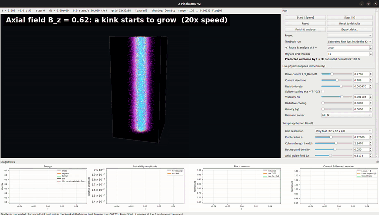
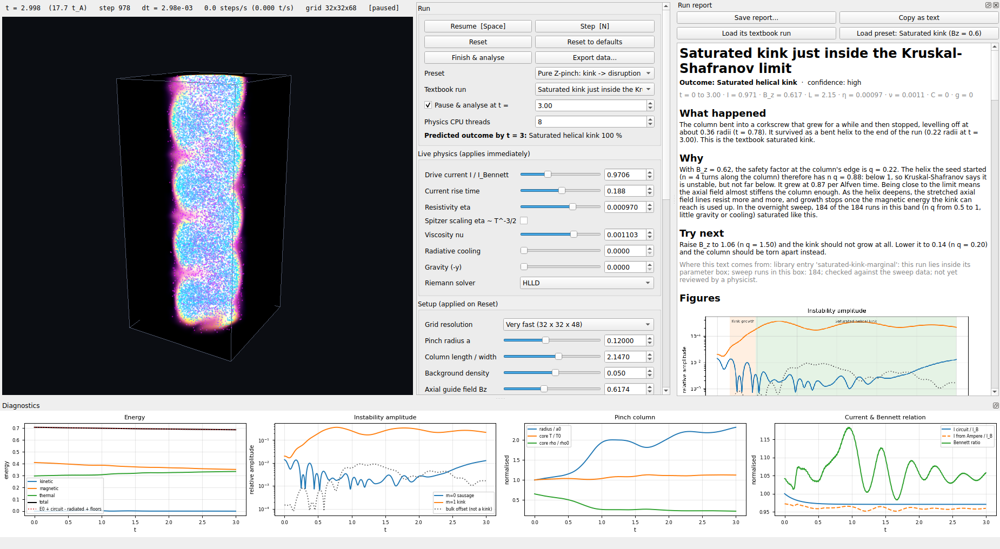
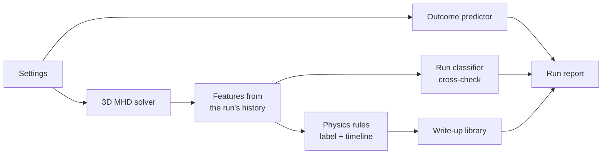

# Dynamic B Field Z Pinch MHD Simulator

**A 3D plasma simulator that watches each run, explains what happened in plain language, and predicts the
outcome before you press Start.**



A Z-pinch is a column of plasma carrying a large current. The current's own magnetic field squeezes the
column, which is how lightning channels and some fusion experiments confine plasma. It is also unstable: the
column can bend into a helix (a *kink*), pinch off into beads (a *sausage*), sag or tear apart. This project
simulates that column in 3D in real time, then tells you which of those happened, why, and what to change.

[▶ Full 55-second demo with the run reports (MP4)](v2/screenshots/zpinch-demo.mp4)

## Contents

- [Highlights](#highlights)
- [Results](#results)
- [The physics](#the-physics)
- [How the simulator works](#how-the-simulator-works)
- [How v3 labels, explains and predicts a run](#how-v3-labels-explains-and-predicts-a-run)
- [Quick start](#quick-start)
- [How it was built](#how-it-was-built)
- [Repository](#repository)
- [Limitations](#limitations)

## Highlights

- **A real MHD solver.** 3D resistive, viscous magnetohydrodynamics with an HLLD Riemann solver, GLM
  divergence cleaning and an external drive circuit. The kernels are compiled with numba, and every unit of
  energy is accounted for (field, kinetic, thermal, gravitational, circuit and losses) to about 10⁻¹⁶.
- **Live and interactive.** A Qt GUI with GPU volume rendering and tracer particles. You can change the
  drive current, resistivity, cooling and gravity while the run is going.
- **It rediscovered a textbook result.** An overnight sweep of 2902 simulations recovered the
  Kruskal-Shafranov kink criterion with no physics put in by hand. Of the runs without gravity or cooling,
  108 of 108 with 0.5 ≤ n q < 1 saturate as a bent helix, and none of the 110 with n q ≥ 1.5 grows a kink.
- **It predicts outcomes from the settings alone.** A model trained on the sweep gets **94.3 %** right on
  runs it never saw. The classic stability number on its own gets 67.6 %.
- **Every run gets a report.** Physics rules label the run, and a curated library of 21 write-ups explains
  it in plain language, with the sweep statistics behind each claim.



*A run paused at t = 3. The column has bent into a helix and stopped growing (a saturated kink); the report on
the right explains why.*

## Results

Trained and tested on the 2902-run sweep, with 562 runs locked away for testing:

| Model | Accuracy | Balanced accuracy |
|---|---|---|
| Run classifier: what happened, from the finished run | 99.3 % | 98.8 % |
| **Outcome predictor: what will happen, from the settings alone** | **94.3 %** | **93.3 %** |
| Baseline: the Kruskal-Shafranov number n q alone | 67.6 % | 44.6 % |

The models, their limits and the figures (confusion matrices, calibration, outcome map) are in
[v2/models/MODEL_CARD.md](v2/models/MODEL_CARD.md).

## The physics

The full from-zero treatment is in [docs/01](docs/01%20-%20Vision.md) (the story) and
[docs/04](docs/04%20-%20V2%20Complete%20Guide.md) (the textbook). This is the condensed version.

### Plasma as a conducting fluid

Heat a gas enough and the electrons are knocked off the atoms; the result, a soup of free electrons and
ions, is a **plasma**. It conducts electricity very well, and a current through it makes magnetic fields that
push back on it. On scales much larger than the distance a particle travels between collisions, the plasma
behaves as one electrically conducting fluid. That is **magnetohydrodynamics (MHD)**: fluid mechanics coupled
to Maxwell's equations.

Three ideas carry most of the intuition:

- **Field lines are frozen into the plasma.** In a perfect conductor, plasma and field lines move together,
  like elastic threads embedded in the fluid. Resistance lets them slowly slip. The **Lundquist number**
  $S = a v_A/\eta$ says which wins (large S means nearly frozen; the default here is S ≈ 280).
- **Field lines have pressure and tension.** The magnetic force $\mathbf{J}\times\mathbf{B}$ splits into a
  pressure $B^2/2\mu_0$ that pushes from strong field to weak, and a tension that straightens bent lines.
  Plucked field lines carry **Alfvén waves** at $v_A = B/\sqrt{\mu_0\rho}$.
- **Plasma beta** $\beta = p/(B^2/2\mu_0)$ compares gas pressure to magnetic pressure. In an equilibrium
  pinch the two balance (β ≈ 1.2 at the column edge here).

### The pinch effect and the Bennett equilibrium

Parallel currents attract. A column carrying current along its axis ($z$) is a bundle of parallel currents,
so it squeezes itself inward: the **pinch effect**, and with the current along $z$, a **Z-pinch**. In 1905
it was used to explain a copper lightning conductor found crushed flat by a strike.

The column sits still when the inward magnetic force balances the outward pressure gradient,
$dp/dr = -J_z B_\theta$. Bennett (1934) found the classic solution. With

```math
B_\theta(r) = \frac{\mu_0 I_B}{2\pi}\,\frac{r}{r^2+a^2},\qquad
J_z(r) = \frac{I_B}{\pi}\,\frac{a^2}{(r^2+a^2)^2},\qquad
p(r) = \frac{p_0}{(1+r^2/a^2)^2},
```

the forces balance everywhere. Integrating over the cross-section gives the **Bennett relation**: the current
needed to hold a column depends only on the particles per unit length $N$ and the temperature,

```math
\frac{\mu_0 I^2}{8\pi} = N k_B (T_e + T_i).
```

The simulation starts from exactly this isothermal Bennett profile, with radius $a = 0.12$ of the box.

### Why it is unstable

An equilibrium can still be unstable, like a pencil balanced on its tip. A Z-pinch has two classic ways to
fall over, labelled by $m$, the number of times the pattern repeats around the column:

- **Sausage ($m = 0$).** Where the column necks, the same current flows through a smaller radius, so
  $B_\theta \propto I/r$ is stronger there, the magnetic pressure is higher, and the neck is squeezed further.
  The column pinches off into beads.
- **Kink ($m = 1$).** Where the column bends, the field lines crowd together on the inside of the bend and
  spread out on the outside. The extra magnetic pressure on the inside pushes the bend further, and the
  column twists into a corkscrew.

Both grow on the **Alfvén time** $t_A = a/v_A$, the time an Alfvén wave takes to cross the column
(t_A ≈ 0.17 here, so an instability shows up within seconds on a laptop).

**An axial field stabilises it.** A field $B_z$ along the column acts as a stiff spine: necking or bending the
column must compress or stretch its field lines, which resist. Two textbook criteria:

- **Sausage (Kadomtsev):** stable roughly when $B_z^2 > B_\theta^2/2$ at the edge.
- **Kink (Kruskal-Shafranov):** a helical kink with $n$ wavelengths along a column of length $L$ is stable
  when $n q > 1$, where the **safety factor** is

```math
q = \frac{2\pi a\,B_z}{L\,B_\theta(a)}.
```

In words: a field line must wind less than once around the column over one wavelength of the kink.

**What the sweep found.** Without being told any of this, the simulator and the labelling rules reproduce the
criterion. Runs without gravity or cooling, sorted by $n q$ of the seeded helix:

| n q | Runs | Outcome |
|---|---|---|
| 0 – 0.25 | 262 | 260 disrupt, 2 saturate |
| 0.25 – 0.5 | 88 | 65 disrupt, 23 saturate |
| **0.5 – 1** | **108** | **all 108 saturate as a bent helix** |
| 1 – 1.5 | 130 | 85 saturate, 19 quiet, 26 resistive |
| **≥ 1.5** | **110** | **none grows a kink** |

Why does full stability set in at 1.5, not 1? For the Bennett profile $q(r) \propto r^2 + a^2$, so **on the
axis q is half its edge value**. Just above $n q = 1$ the inner column is still unstable, which is why kinks
there stay small (median peak 0.19 a, against 0.39 a below $n q = 1$).

### Other ways the column ends

- **Drive and compression.** The current comes from an external circuit (an RL circuit with a rise time).
  At the Bennett current the walls hold exactly the starting field. Raise it, and a compression wave
  ("snowplow") sweeps inward, squeezes and heats the column, which overshoots and oscillates about a new
  balance.
- **Resistive diffusion and Ohmic heating.** Resistance lets the field slip out of the plasma and turns
  current into heat ($\eta J^2$). Optionally the resistivity follows Spitzer's law $\eta \propto T^{-3/2}$:
  hotter plasma conducts better.
- **Radiative collapse.** Hot, dense plasma emits bremsstrahlung X-rays, $Q_\text{rad} = C\rho^2\sqrt{T}$.
  If the column radiates faster than it is heated, it cools, loses pressure, is squeezed denser, radiates
  more, and collapses.
- **Gravity sag.** With gravity on, the heavy column falls against the magnetic field that holds it.

### The equations

Single-fluid resistive, viscous MHD in conservation form (units with $\mu_0 = 1$):

```math
\begin{aligned}
\partial_t\rho + \nabla\cdot(\rho\mathbf{v}) &= 0 \\
\partial_t(\rho\mathbf{v}) + \nabla\cdot\Big[\rho\mathbf{v}\mathbf{v} + \big(p + \tfrac12B^2\big)\mathbf{I} - \mathbf{B}\mathbf{B} - \boldsymbol\tau\Big] &= \rho\mathbf{g} \\
\partial_t E + \nabla\cdot\Big[\big(E + p + \tfrac12B^2\big)\mathbf{v} - \mathbf{B}(\mathbf{v}\cdot\mathbf{B}) + \eta\,\mathbf{J}\times\mathbf{B} - \boldsymbol\tau\cdot\mathbf{v}\Big] &= \rho\mathbf{v}\cdot\mathbf{g} - Q_\text{rad} \\
\partial_t\mathbf{B} + \nabla\cdot(\mathbf{v}\mathbf{B} - \mathbf{B}\mathbf{v}) + \nabla\times(\eta\mathbf{J}) &= 0 \\
\nabla\cdot\mathbf{B} &= 0
\end{aligned}
```

with total energy $E = \frac{p}{\gamma-1} + \frac12\rho v^2 + \frac12B^2$, current $\mathbf{J} = \nabla\times\mathbf{B}$,
viscous stress $\boldsymbol\tau = \rho\nu\big(\nabla\mathbf{v} + \nabla\mathbf{v}^T - \tfrac23(\nabla\cdot\mathbf{v})\mathbf{I}\big)$
and $\gamma = 5/3$. Each line reads "change inside = flow in − flow out + source". The lines are, in order:
mass conservation; Newton's second law with gas pressure, magnetic pressure, magnetic tension, friction and
gravity; energy conservation (the bracket includes the Poynting flux); Faraday's and Ohm's laws (the field is
carried by the flow and slips by resistance); and no magnetic monopoles.

There is **no hand-written heating term**. Because total energy is conserved, any kinetic or magnetic energy
that friction or resistance removes stays in $E$ and shows up as heat, and shock heating falls out of the
Riemann solver.

**Units.** Everything is dimensionless, scaled to the column's peak density and pressure and the box width,
so one run describes every machine with the same proportions. As an illustration, a 1 cm box of deuterium at
10²⁴ m⁻³ and 100 eV makes the time unit about 100 ns, the field unit about 6.3 T and the Bennett current
about 54 kA.

## How the simulator works

A **finite-volume** scheme: each cell is a bank account of mass, momentum, energy and magnetic field, and
changes only by what flows through its faces.

| Step | Method | Why |
|---|---|---|
| Reconstruction | piecewise-linear (PLM), van Leer slope limiter | second-order accurate without inventing new peaks |
| Face fluxes | **HLLD** Riemann solver (Miyoshi & Kusano 2005), HLL as an option | resolves the fast, Alfvén and contact waves at each face |
| Time stepping | SSP-RK2 (predict, then correct), CFL number 0.3 | second-order in time and stable |
| ∇·B = 0 | GLM divergence cleaning, solved inside the Riemann problem | numerical errors in ∇·B travel away and decay |
| Resistivity, viscosity | separate flux pass, accumulated over up to 8 steps within its own stability limit | diffusion is ~60× slower than the waves, so this halves the cost |
| Near-vacuum | density and temperature floors, **every correction added to the energy tally** | keeps the time step finite without hiding energy |
| Boundaries | conducting side walls carrying the drive field; periodic along the axis | the current enters through the walls, as in a real machine |

**The energy budget closes exactly.** The code tallies every way the total can change (circuit work through
the walls, radiation, floors) and checks it against the actual change in the box every step:

```math
\int (E + \rho\Phi)\,dV\,\Big|_0^{t} = W_\text{circuit} - E_\text{rad} + E_\text{floors}
```

The mismatch is shown live in the GUI and is about 10⁻¹⁶ (the last digit a double-precision number holds).

**Validation** (`./test.sh`) against problems with exact answers, along every axis:

| Test | Result |
|---|---|
| Sod shock tube (gas-only limit) | density error 2.3 × 10⁻³ at 256 cells |
| Circularly polarised Alfvén wave (exact nonlinear MHD wave) | errors 8.3 × 10⁻³ / 3.3 × 10⁻³ / 9.1 × 10⁻⁴ at 16 / 32 / 64 cells, order → 1.85 |
| Resistive and viscous decay $e^{-Dk^2t}$ | rates within 1.6 × 10⁻⁴, energy conserved to 10⁻¹³ |
| Driven pinch with every physics term on | mass and energy budgets below 10⁻¹² |
| Bennett equilibrium | stays balanced, spurious flow shrinking with resolution |
| Kink | grows ×3 by t = 0.6 |

## How v3 labels, explains and predicts a run



1. **Simulate.** The solver records diagnostics every step: radius, kink and sausage amplitudes, energies,
   current.
2. **Label.** 65 features are read from that history, and physics rules sort the run into one of 8 outcome
   classes (radiative collapse, kink → disruption, sausage, kink still growing, saturated kink, gravity sag,
   resistive diffusion, quiescent), with a timeline of events. Every threshold is commented with its reason
   and the sweep runs that justify it, and a label within 15 % of a threshold is flagged as borderline.
3. **Explain.** The energy bookkeeping says which store paid for each phase (a kink is paid for by the
   magnetic field and ends up as heat), and a table compares the textbook criteria (Kruskal-Shafranov,
   Kadomtsev, Lundquist, cooling time) with what the run did. The library entry whose regime matches the run
   is filled in with the run's own numbers and the sweep's counts. There is no free text generation, so no
   invented physics.
4. **Predict and cross-check.** Gradient-boosted decision trees trained on the sweep predict the outcome from
   the settings before the run, and re-classify it from the features afterwards. When the classifier
   disagrees with the rules, that disagreement is a bug report; two rule weaknesses were found and fixed
   that way.

The sweep varied 8 settings (current, rise time, axial field, resistivity, viscosity, cooling, gravity,
column length) over 2902 runs in one night on a laptop. 60 runs were repeated on a finer grid as a
resolution check, and 59 kept their label.

## Quick start

Tested on Linux with Python 3.10.

```bash
cd v2
python3 -m venv .venv
.venv/bin/python -m pip install -r requirements.txt
./run.sh            # GUI: pick a Textbook run, press Start
```

The first launch compiles the numba kernels (20–40 s, cached afterwards). Headless runs, reports and the
training tools are listed in [v2/README.md](v2/README.md#run). `./test.sh` runs the test suite (physics
validation, analysis, library and report).

**Built with:** Python · NumPy · numba · scikit-learn · PyQt5 · vispy (OpenGL) · matplotlib · pytest

## How it was built

The project went through three versions, and the way it was built changed between them.

**v1: architected and designed by me, implemented by a friend.** I architected and fully designed the
program: the physics it had to include, the module structure, the setup/live parameter split, tracer
particles, the 3D view, the diagnostics and the rule that the energy must add up
([docs/01 §3](docs/01%20-%20Vision.md)). A friend implemented it from my spec. The architecture held up, but
the numerical core could not work. Measured later: energy grew ×2,700 in 3 steps and the state was NaN within
36 steps even with the current off, and one step at the default grid took 20 s and 12.7 GB. The causes were
an unconditionally unstable update rule (FTCS), a 10⁸ pressure cliff with nothing to hold it, and terms that
were not physics, such as a field "nudged" toward a target shape. The post-mortem is
[docs/02](docs/02%20-%20V1%20and%20Why%20It%20Failed.md).

**v2: bug-fixed and accelerated by Claude.** Claude Code (an AI coding agent) did all of v2. It replaced the
numerics with a validated finite-volume solver, fixed every bug in the post-mortem, compiled the physics with
numba and moved the 3D view to GPU ray-cast volume rendering. A step went from 19.9 s to 9.6 ms, and memory
from 12.7 GB to under 1.2 GB. [docs/03](docs/03%20-%20V2%20Changes%20and%20Fixes.md) lists every change.

**v3: agentically engineered by me.** I engineered v3 by directing Claude Code: I set the design and the
decisions, and the agent wrote the code to them. Before any code was written I decided: classify finished runs
first, then predict from the settings; explanations from a fixed, curated library rather than generated text;
plain language for students with full data underneath for researchers; one overnight sweep of compute; and
show low confidence and unreviewed text rather than hide it ([docs/05](docs/05%20-%20V3%20Plan.md) §0). I
drove it phase by phase, including the sweep, the models and the docs, and made the calls along the way, such
as adding scikit-learn and resuming the sweep. Every threshold in the code carries a comment with its reason
and the run that justifies it, and [docs/06](docs/06%20-%20V3%20Technical%20Overview.md) explains all of it
from zero.

This README was written by Claude from the code, the docs and the git history.

## Repository

| Path | What's there |
|---|---|
| [`v2/`](v2/) | The program: solver, GUI and the v3 analysis. [v2/README.md](v2/README.md) has the commands and code layout. |
| [`docs/`](docs/) | Design notes, written to be read from zero: 01 vision, 02 v1 post-mortem, 03 v2 fixes, 04 complete guide, 05 v3 plan and phase write-ups, 06 v3 technical overview. |
| [`v1/`](v1/) | The first attempt, kept for the record. |

## Limitations

- Everything is in dimensionless code units, not a model of a specific machine.
- Single-fluid MHD: no separate electron and ion temperatures, no Hall effect, no kinetic effects.
- The sweep used one grid (32 × 32 × 48). 59 of 60 runs repeated on a finer 48³ grid kept their label, but
  growth rates and the exact stability line shift with resolution.
- The predictor only knows the settings the sweep varied. The GUI warns you when you leave that range.
- The write-ups were checked against the data but have not been reviewed by a plasma physicist.

## License

[MIT](LICENSE)
