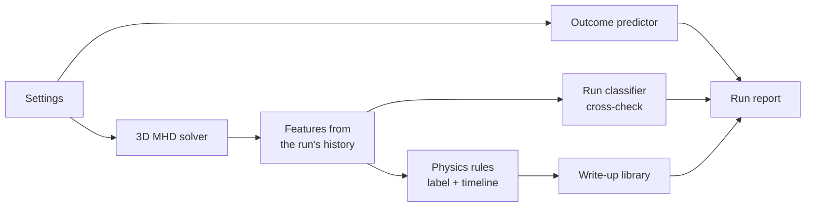

# Z-Pinch MHD

**A 3D plasma simulator that watches each run, explains what happened in plain language, and predicts the
outcome before you press Start.**


A Z-pinch is a column of plasma carrying a large current. The current's own magnetic field squeezes the
column, which is how lightning channels and some fusion experiments confine plasma. It is also unstable: the
column can bend into a helix (a *kink*), pinch off into beads (a *sausage*), sag or tear apart. This project
simulates that column in 3D in real time, then tells you which of those happened, why, and what to change.

[▶ Full 55-second demo with the run reports (MP4)](v2/screenshots/zpinch-demo.mp4)

## Highlights

- **A real MHD solver, written from scratch.** 3D resistive magnetohydrodynamics with an HLLD Riemann
  solver, GLM divergence cleaning, viscosity and an external drive circuit. The kernels are compiled with
  numba, and every unit of energy is accounted for (field, kinetic, thermal, circuit and losses).
- **Live and interactive.** A Qt GUI with GPU volume rendering and tracer particles. You can change the
  drive current, resistivity, cooling and gravity while the run is going.
- **It rediscovered a textbook result.** An overnight sweep of 2902 simulations recovered the
  Kruskal-Shafranov kink criterion with no physics put in by hand. Of the runs without gravity or cooling,
  108 of 108 with 0.5 ≤ n q < 1 saturate as a bent helix, and none of the 110 with n q ≥ 1.5 grows a kink.
- **It predicts outcomes from the settings alone.** A model trained on the sweep gets **94.3 %** right on
  runs it never saw. The classic stability number on its own gets 67.6 %.
- **Every run gets a report.** Physics rules label the run, and a curated library of 21 write-ups explains
  it in plain language, with the sweep statistics behind each claim.


*A run paused at t = 3. The column has bent into a helix and stopped growing (a saturated kink); the report on
the right explains why.*

## Results

Trained and tested on the 2902-run sweep, with 562 runs locked away for testing:

| Model | Accuracy | Balanced accuracy |
|---|---|---|
| Run classifier: what happened, from the finished run | 99.3 % | 98.8 % |
| **Outcome predictor: what will happen, from the settings alone** | **94.3 %** | **93.3 %** |
| Baseline: the Kruskal-Shafranov number n q alone | 67.6 % | 44.6 % |

The models, their limits and the figures (confusion matrices, calibration, outcome map) are in
[v2/models/MODEL_CARD.md](v2/models/MODEL_CARD.md).

## How it works



1. **Simulate.** The solver evolves a Bennett equilibrium driven by an external circuit and records
   diagnostics every step: radius, kink amplitude, energies, current.
2. **Label.** 65 features are read from that history, and physics rules sort the run into one of the outcome
   classes (quiescent, saturated kink, disruption, sag, resistive, radiative collapse, sausage) with a
   timeline of events.
3. **Explain.** The write-up whose parameter range matches the run most closely is chosen, filled in with
   the run's own numbers and the sweep's counts.
4. **Predict and cross-check.** Gradient-boosted models trained on the sweep predict the outcome from the
   settings before the run, and re-classify it from the features afterwards.

## Quick start

Tested on Linux with Python 3.10.

```bash
cd v2
python3 -m venv .venv
.venv/bin/python -m pip install -r requirements.txt
./run.sh            # GUI: pick a Textbook run, press Start
```

The first launch compiles the numba kernels (20–40 s, cached afterwards). Headless runs, reports and the
training tools are listed in [v2/README.md](v2/README.md#run). `./test.sh` runs the test suite (physics
validation, analysis, library and report).

## Built with

Python · NumPy · numba · scikit-learn · PyQt5 · vispy (OpenGL) · matplotlib · pytest

## Repository

| Path | What's there |
|---|---|
| [`v2/`](v2/) | The program: solver, GUI and the v3 analysis. [v2/README.md](v2/README.md) has the commands and code layout. |
| [`docs/`](docs/) | Design notes. [06 - V3 Technical Overview](docs/06%20-%20V3%20Technical%20Overview.md) explains everything from zero, fluid mechanics included. |
| [`v1/`](v1/) | The first attempt, kept for the record. [Why it failed](docs/02%20-%20V1%20and%20Why%20It%20Failed.md). |

## Limitations

- Everything is in dimensionless code units, not a model of a specific machine.
- The sweep used one grid (32 × 32 × 48). 59 of 60 runs repeated on a finer 48³ grid kept their label, but
  growth rates and the exact stability line shift with resolution.
- The predictor only knows the settings the sweep varied. The GUI warns you when you leave that range.
- The write-ups were checked against the data but have not been reviewed by a plasma physicist.
