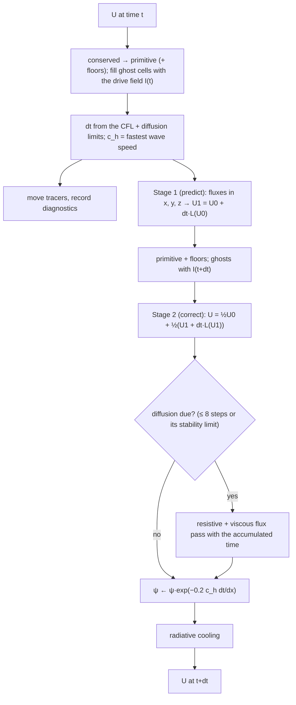
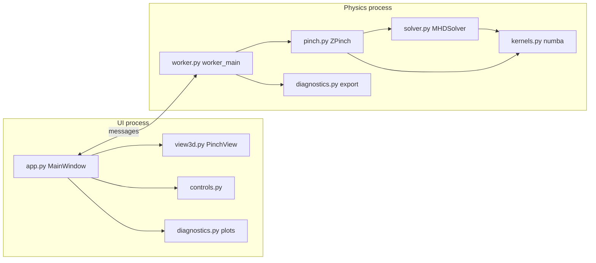
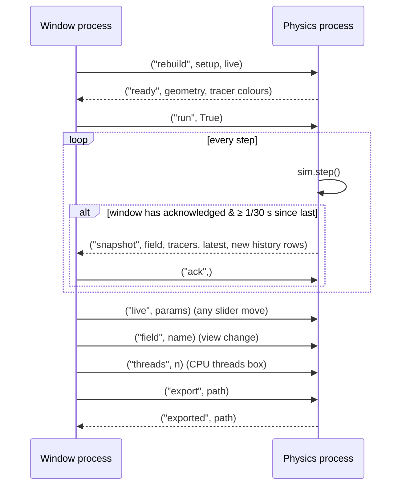

# 04 · Z-Pinch MHD v2 — the complete guide

Series: [[01 - Vision]] → [[02 - V1 and Why It Failed]] → [[03 - V2 Changes and Fixes]] → **04 V2 Complete Guide**

> [!info] How to use this guide
> This note is a **manual and a small textbook** in one. It assumes high-school physics and basic programming; everything else is built up from there.
> - **New to the physics or to simulations?** Read *Part I — Foundations* first (about an hour). Each section ends with a one-line "**Where it shows up in the program**".
> - **Just want to use the program?** *Quick start* → *Your first session* → *Reading the plots* → *Tutorials*.
> - **Want to know how it works inside?** Part III, then *A guided tour of the code*.
> - Every unfamiliar word is in the **Glossary** at the end.

---

## Contents

- **Part I — Foundations**: [[#0.1 Numbers, vectors and fields]] · [[#0.2 Calculus without fear]] · [[#0.3 Fluids]] · [[#0.4 Electricity and magnetism]] · [[#0.5 Plasma and MHD]] · [[#0.6 Equilibrium, stability and growth]] · [[#0.7 Computing for simulation]]
- **Part II — Using the program**: [[#Quick start]] · [[#Your first session]] · [[#The window, piece by piece]] · [[#Reading the plots]] · [[#Tutorials — experiments to run]] · [[#Exercises (with answers)]]
- **Part III — How it works**: [[#Units]] · [[#The physics model]] · [[#Numerical method]] · [[#The Z-pinch setup]]
- **Part IV — Reference**: [[#Parameter reference]] · [[#Diagnostics reference]] · [[#Export and headless runs]] · [[#Troubleshooting]] · [[#FAQ]]
- **Part V — The code**: [[#Code architecture]] · [[#A guided tour of the code]] · [[#Validation suite]] · [[#Performance and tuning]]
- **Part VI — Limits, words, sources**: [[#Limitations and roadmap]] · [[#Glossary]] · [[#References]]

---

## Part I — Foundations

### 0.1 Numbers, vectors and fields

**Scientific notation.** $10^{-16}$ (written `1e-16` in code) means 0.0000000000000001 — sixteen places after the decimal point. $3\times10^{7}$ is 30,000,000. You'll see `1e-16` a lot: it's the precision limit of a computer number (§0.7).

**Scalars and vectors.** A **scalar** is a single number: density, temperature, pressure. A **vector** is an arrow — a size *and* a direction — written in bold ($\mathbf{v}$ for velocity, $\mathbf{B}$ for magnetic field). In 3D a vector has three **components**, e.g. $\mathbf{v} = (v_x, v_y, v_z)$. Its **magnitude** (length) is

$$
|\mathbf{v}| = \sqrt{v_x^2 + v_y^2 + v_z^2}.
$$

Two ways to multiply vectors appear in plasma physics:

- **Dot product** $\mathbf{A}\cdot\mathbf{B} = A_xB_x + A_yB_y + A_zB_z$ — a *number*: how much the two arrows point the same way (zero if perpendicular). Example: $\mathbf{v}\cdot\mathbf{g}$ measures how fast you're falling along gravity.
- **Cross product** $\mathbf{A}\times\mathbf{B}$ — a *new arrow perpendicular to both*, with length $|\mathbf{A}||\mathbf{B}|\sin\theta$. Direction by the **right-hand rule**: fingers along $\mathbf{A}$, curl them toward $\mathbf{B}$, thumb gives $\mathbf{A}\times\mathbf{B}$. The magnetic force on a current, $\mathbf{J}\times\mathbf{B}$, is a cross product — which is why it points *sideways* (inward for a pinch), not along the current or the field.

**Fields.** A **field** is a quantity that has a value at *every point in space*. A weather temperature map is a **scalar field**; a wind map (an arrow at every point) is a **vector field**. A **field line** is a curve that follows the arrows everywhere, like a stream in the wind map.

**Coordinates used here.** The box is $x, y \in [-\tfrac12, \tfrac12]$, with the plasma column along $z$. Around a column it's natural to use the distance from the axis $r = \sqrt{x^2+y^2}$ and the angle $\theta$ around it. "**Azimuthal**" means "pointing around the axis" — the magnetic field of a pinch, $B_\theta$, is azimuthal; "**axial**" means "along $z$".

**Sums and integrals.** $\int \rho\,dV$ ("the integral of density over volume") is just the **total mass**: in the program it's literally "add up density × cell volume over all cells", $\sum_\text{cells}\rho\,\Delta x^3$.

> **Where it shows up:** every quantity in the program is a scalar or vector field stored per cell; *magnetic energy* in the diagnostics panel is $\sum \tfrac12|\mathbf{B}|^2\Delta x^3$.

### 0.2 Calculus without fear

**Rate of change.** $\frac{dq}{dt}$ means "how fast $q$ changes per unit time". If a tank gains 3 litres per minute, $\frac{dV}{dt} = 3$. A simulation lives on this idea: *new value = old value + $\Delta t$ × rate of change*.

**Partial derivatives.** In a field, $q$ depends on position and time. $\frac{\partial q}{\partial t}$ ("partial q partial t", also written $\partial_t q$) is the rate of change **at a fixed point**; $\frac{\partial q}{\partial x}$ is the slope **along $x$** at a fixed time. On a grid, a slope is just a difference between neighbours:

$$
\frac{\partial q}{\partial x} \approx \frac{q_{i+1} - q_{i-1}}{2\Delta x}.
$$

**The nabla operators** ($\nabla$, "del"). Four combinations appear everywhere; each has a picture:

| Symbol | Name | Acts on → gives | Picture | Example in the program |
|---|---|---|---|---|
| $\nabla p$ | gradient | scalar → vector | the arrow pointing **uphill**, length = steepness | pressure pushes plasma **down** its gradient: force $-\nabla p$ |
| $\nabla\cdot\mathbf{v}$ | divergence | vector → scalar | net **outflow** from a tiny box (positive = spreading out, negative = converging) | mass conservation: density drops where $\nabla\cdot(\rho\mathbf{v}) > 0$ |
| $\nabla\times\mathbf{B}$ | curl | vector → vector | the **swirl** of the arrows around a point | Ampère: current density $\mathbf{J} = \nabla\times\mathbf{B}$ — current lives where the field swirls |
| $\nabla^2 q$ | Laplacian | scalar → scalar | how much a point differs from the **average of its neighbours** | diffusion: $\partial_t q = D\nabla^2q$ pulls every point toward its neighbours' average → smoothing |

```
 gradient            divergence          curl
   ↗↗↗              ←  ·  →             ↻ ↻
   ↗↗↗  uphill      ↙  ↓  ↘  outflow    ↻ ↻  swirl
```

**Exponential growth and logarithms.** Something that grows by a fixed *fraction* per unit time follows $A(t) = A_0e^{\gamma t}$; $\gamma$ is the **growth rate**. Plot $A$ on a **logarithmic** vertical axis and exponential growth becomes a **straight line** whose slope is $\gamma$ (if the axis is $\ln A$). The **doubling time** is $\ln 2/\gamma \approx 0.69/\gamma$. Instabilities grow exponentially while small — this is why the program's instability plot is logarithmic.

> **Where it shows up:** *Instability amplitude* plot (log axis); the code's `_dface` and `derived_field` functions compute exactly the neighbour-difference slopes above.

### 0.3 Fluids

A fluid (gas, liquid, plasma) at each point has:

| Quantity | Symbol | Meaning | Everyday picture |
|---|---|---|---|
| density | $\rho$ | mass per volume | how packed the stuff is |
| velocity | $\mathbf{v}$ | how fast and which way it moves | wind |
| pressure | $p$ | force per area from particles hitting a surface | tyre pressure |
| temperature | $T$ | average random (jiggling) energy of particles | how hot |

For an ideal gas these are tied by the **ideal gas law** $p = n k_B T$ ($n$ = particles per volume). In the program's units it's simply $p = \rho T$.

**Conservation laws — "change inside = in − out".** Draw an imaginary box. The mass inside can only change by mass flowing through its surface:

$$
\frac{\partial\rho}{\partial t} + \nabla\cdot(\rho\mathbf{v}) = 0
$$

*Read it as:* (rate density increases here) + (net outflow of mass per volume) = 0. The quantity $\rho\mathbf{v}$ is a **flux**: mass crossing a unit area per unit time. Momentum and energy obey the same pattern, plus forces/sources. This "in − out" structure is the backbone of the numerical method (§ Numerical method).

**Newton's second law for a fluid.** Per unit volume, mass × acceleration = forces:

$$
\rho\frac{D\mathbf{v}}{Dt} = -\nabla p + \underbrace{\mathbf{J}\times\mathbf{B}}_{\text{magnetic}} + \underbrace{\nabla\cdot\boldsymbol\tau}_{\text{viscous}} + \rho\mathbf{g}
$$

*In words:* fluid accelerates from high to low pressure, is pushed by magnetic forces, is dragged by friction with neighbouring fluid, and falls under gravity. ($D/Dt$ means "following the moving fluid parcel".)

**Energy.** A fluid stores **kinetic energy** $\tfrac12\rho v^2$ (motion) and **internal energy** $\frac{p}{\gamma-1}$ (heat). $\gamma$ ("gamma", the *adiabatic index*) is $5/3$ for a gas of single particles such as a fully ionised plasma. **Compressing a gas heats it** (feel a bicycle pump get warm); expanding cools it.

**Sound waves and shocks.** Pressure disturbances travel at the **sound speed** $c_s = \sqrt{\gamma p/\rho}$. A strong compression steepens into a **shock** — an almost instantaneous jump in density, pressure and temperature that *irreversibly* turns motion into heat (a sonic boom). Shocks are the hardest thing for simulation codes to handle, and why v2 uses a Riemann solver.

**Viscosity.** Internal friction between neighbouring layers moving at different speeds (honey is very viscous). It smooths velocity differences and turns motion into heat. Strength: the **kinematic viscosity** $\nu$.

> **Where it shows up:** density, pressure, temperature and speed are selectable *Fields*; kinetic and thermal energies are in the diagnostics; the *Viscosity* slider sets $\nu$.

### 0.4 Electricity and magnetism

**Charge and current.** Electrons carry negative charge, ions positive. A **current** $I$ (amperes) is charge flowing per second. In a volume of plasma we use the **current density** $\mathbf{J}$: current per unit area, a vector pointing along the flow of positive charge.

**Magnetic field.** Moving charges (currents) create a **magnetic field** $\mathbf{B}$ (tesla). Two facts matter most:

1. **Field lines never start or end** — there are no magnetic "charges" (monopoles). Mathematically $\nabla\cdot\mathbf{B} = 0$ (zero divergence: no sources or sinks). A simulation must respect this or it creates fake forces.
2. **Currents make the field swirl around them (Ampère's law).** Around a straight current $I$, $B_\theta = \mu_0I/(2\pi r)$. In differential form, $\mu_0\mathbf{J} = \nabla\times\mathbf{B}$: wherever the field swirls, a current flows.

**The magnetic force.** A charge $q$ moving at $\mathbf{v}$ feels $\mathbf{F} = q(\mathbf{E} + \mathbf{v}\times\mathbf{B})$ (the **Lorentz force**). Summed over a plasma, the force per unit volume is $\mathbf{J}\times\mathbf{B}$. It can be split into two intuitive parts:

$$
\mathbf{J}\times\mathbf{B} = \underbrace{-\nabla\!\left(\frac{B^2}{2\mu_0}\right)}_{\text{magnetic pressure}} + \underbrace{\frac{(\mathbf{B}\cdot\nabla)\mathbf{B}}{\mu_0}}_{\text{magnetic tension}}
$$

- **Magnetic pressure** $B^2/2\mu_0$: a region of strong field pushes outward on its surroundings, like a gas.
- **Magnetic tension**: field lines behave like **stretched rubber bands** — they try to straighten and shorten.

In a Z-pinch the field lines are **circles around the column**. Like rubber bands wrapped around a bundle of sticks, their tension squeezes the column inward. That *is* the pinch force.

**Faraday's law and induction.** A changing magnetic field creates an electric field ($\partial_t\mathbf{B} = -\nabla\times\mathbf{E}$) — the principle of transformers and generators. In a plasma it means moving plasma and changing field are tightly linked.

**Ohm's law and resistance.** In a resistor, $\mathbf{E} = \eta\mathbf{J}$: some electric field is needed to push current through resistance $\eta$, and the work done becomes heat — **Ohmic (Joule) heating**, power $\eta J^2$ per volume (a toaster). In a moving plasma Ohm's law reads $\mathbf{E} + \mathbf{v}\times\mathbf{B} = \eta\mathbf{J}$.

**Energy in fields and how it travels.** A magnetic field stores energy $B^2/2\mu_0$ per volume. Electromagnetic energy flows through space along the **Poynting vector** $\mathbf{S} = \mathbf{E}\times\mathbf{B}/\mu_0$ — this is literally how a power line delivers energy, and how the drive circuit delivers energy into the simulated box.

> **Where it shows up:** *Magnetic field |B|*, *Current density |J|* and *Axial current J_z* fields; the *Drive current* slider; *circuit energy in* (Poynting flux through the walls); *max |divB|* monitors fact 1.

### 0.5 Plasma and MHD

**From particles to a fluid.** A plasma has trillions of electrons and ions per cubic millimetre. When we look at scales much bigger than the distances particles travel between collisions, we can treat it as **one electrically conducting fluid** — that's **magnetohydrodynamics (MHD)**. It's **quasi-neutral** (positive and negative charge nearly cancel in every small volume), so it carries currents without building up charge.

**Field lines are frozen into the plasma.** In a perfectly conducting plasma, plasma and field lines move together — as if the field lines were **elastic threads embedded in the fluid**. Push the plasma and you drag the field; pull the field and you drag the plasma. With **resistance** the threads can slowly **slip** through the fluid (diffuse) and even break and reconnect (**magnetic reconnection**). Which wins is measured by the **Lundquist number** $S = L v_A/\eta$ (big $S$ = nearly frozen). Lab plasmas have huge $S$; the program's default is $S \approx 280$.

**Alfvén waves.** Pluck a stretched string and a wave runs along it. Field lines under tension, loaded with plasma mass, do the same: the **Alfvén wave**, travelling at

$$
v_A = \frac{B}{\sqrt{\mu_0\rho}}.
$$

*Stronger field → faster; heavier plasma → slower.* There are also **fast and slow magnetosonic waves** (combinations of sound and magnetic compression). The fastest of all, the **fast speed** $c_f$, sets the simulation time step.

**Plasma beta.** $\beta = \dfrac{p}{B^2/2\mu_0}$ — gas pressure ÷ magnetic pressure. $\beta \gg 1$: the gas dominates; $\beta \ll 1$: the magnetic field dominates. In the default pinch, $\beta \approx 1.2$ at the column edge (they're balanced — that's what an equilibrium is).

**Spitzer resistivity.** A plasma's resistance comes from electrons bumping into ions. Hotter electrons move faster and collide less, so resistance **falls** with temperature: $\eta \propto T^{-3/2}$.

**Bremsstrahlung.** "Braking radiation": electrons swerving past ions emit X-rays. Power per volume $\propto n^2\sqrt{T}$ — dense plasma radiates much more. If a pinch radiates faster than it is heated it can collapse further (*radiative collapse*).

**The MHD equations, in one sentence each.** Mass is conserved; momentum changes by pressure, magnetic and friction forces; energy changes only by flowing around (or out through the walls); the field is carried by the flow and slips by resistance; field lines never end. The full equations are in [[#The physics model]].

> **Where it shows up:** *Plasma beta* field; *Resistivity* and *Spitzer* controls; *Radiative cooling*; the time step on the status bar (set by $c_f$).

### 0.6 Equilibrium, stability and growth

**Equilibrium** means all forces balance, so nothing accelerates. **Stable** means a small disturbance dies away (marble in a bowl); **unstable** means it grows (pencil on its tip).

```
   stable                 unstable
   \_o_/                    _o_
                           /   \
```

**Linear growth.** While a disturbance is small, an unstable one grows **exponentially**, $A \propto e^{\gamma t}$. Once it's big it can't keep growing forever — it **saturates** (nonlinear phase) and the structure is destroyed or settles into a new state.

**Modes.** Any bumpy shape can be built from smooth waves (Fourier's idea), so we describe disturbances by their **wavelength** $\lambda$ along the column (or **wavenumber** $k = 2\pi/\lambda$) and their **azimuthal number** $m$ (how many times the pattern repeats around the column). For a pinch:

- **$m=0$, sausage.** The column necks. At a neck the same current flows through a smaller radius, so $B = \mu_0I/2\pi r$ is **stronger**, the magnetic pressure is **larger**, and the neck is squeezed further. Self-reinforcing → unstable.
- **$m=1$, kink.** The column bends. On the inside of the bend the circular field lines are **crowded** (strong field, high magnetic pressure); on the outside they're **spread out**. The pressure difference pushes the bend outward — further. Self-reinforcing → unstable.

**Stabilising with an axial field.** Add a field $B_z$ along the column. Those field lines are frozen into the plasma, so necking or bending the column must **compress or stretch** them — and their pressure and tension resist. Two classic criteria:

- **Sausage (Kadomtsev):** roughly stable when $B_z^2 > B_\theta^2/2$ at the edge.
- **Kink (Kruskal–Shafranov):** stable when the **safety factor** $q = \dfrac{2\pi a\,B_z}{L\,B_\theta} > 1$ — a field line must go less than one turn around the column over the column's length $L$. Longer columns need more $B_z$.

**The natural clock.** Pinch instabilities grow on the **Alfvén time** $t_A = a/v_A$ (the time an Alfvén wave takes to cross the column radius). Growth rates are therefore quoted "per $t_A$"; a rate of 0.84 per $t_A$ means the amplitude grows by $e^{0.84}\approx 2.3\times$ every $t_A$.

> **Where it shows up:** *Seed perturbation* and *Axial guide field* setup controls; the *Instability amplitude* plot (m=0 and m=1); the status bar shows time in $t_A$.

### 0.7 Computing for simulation

**Discretisation.** The computer can't store a value at *every* point, so the box is split into $N\times N\times N_z$ **cells**, each storing **averages**. Cell width $\Delta x = 1/N$. More cells = finer detail but more work: $N^3$ cells × (about $N$ time steps, because smaller cells need smaller steps) → **cost ∝ $N^4$**. Doubling the resolution costs 16×.

**Time steps and the CFL condition.** Each step advances time by $\Delta t$. Information (waves) must not jump more than about one cell per step, so $\Delta t \le C\,\Delta x/(\text{fastest speed})$ with $C < 1$ (v2 uses 0.3). See the toy experiment in [[02 - V1 and Why It Failed]] for what happens otherwise.

**Accuracy and convergence.** The error of a method shrinks like $\Delta x^p$; $p$ is its **order**. v2 is **second order**: halve the cell size and errors drop ~4×. A result you trust should change less and less as you refine the grid — that's **convergence**, and the tests check it.

**Stability vs accuracy vs conservation.** Three separate properties (see [[02 - V1 and Why It Failed]]): a method can conserve perfectly and still explode.

**Computer numbers.** A standard number (**float64**, "double") is 8 bytes and holds about **16 significant digits**. Arithmetic rounds to that precision, so "error ~$10^{-16}$" means "correct to the last digit". **NaN** ("not a number") appears from undefined operations like 0/0 and poisons everything it touches.

**Memory.** Size = cells × variables × 8 bytes. The *Fast* grid with its 2-cell border is $52\times52\times76 \approx 205{,}000$ cells; nine variables → 14.8 MB per copy of the state.

**Interpreted vs compiled.** Plain Python runs each line through an interpreter — great for flexibility, but a loop over millions of cells is slow (tens of nanoseconds per simple operation, plus overhead). **numba** translates marked Python functions into **machine code** (like C) the first time they run — "just-in-time" (**JIT**) compilation — and caches the result on disk. That's why the *first* launch spends ~20–40 s "compiling physics kernels" and later launches start quickly.

**Parallelism.** A modern CPU has several **cores**; each can run a **thread**. numba's `prange` splits a loop across threads. Laptop CPUs like the i5-12450HX mix fast *performance* cores with slower *efficiency* cores, so work is handed out in small chunks so that no thread is left waiting for a slow one. Python's **GIL** (global interpreter lock) lets only one thread run *Python* code at a time; numba code releases it, but the window and the physics would still fight over it — so v2 runs the physics in a **separate process** (a separate program with its own memory) and sends it messages.

**GPU rendering.** The 3D picture is drawn by the graphics card with **ray casting**: for every screen pixel, a ray is shot through the box and samples the field along the way. *Additive/glow* adds up what it passes (like looking through glowing gas), *MIP* keeps the maximum, *translucent* blends front-to-back like coloured smoke, and *isosurface* stops at the first point above a threshold and shades it like a solid surface.

**Virtual environment.** `v2/.venv` is a private copy of Python plus exactly the libraries this program needs (numpy, numba, vispy, PyQt5…), so it doesn't clash with other projects.

> **Where it shows up:** *Grid resolution* presets; *Physics CPU threads*; *dt* and *steps/s* on the status bar; the first-launch compile message.

---

## Part II — Using the program

### Quick start

**Run it**

```bash
cd ~/MHD/v2
./run.sh
```

The first launch shows *"Compiling physics kernels (first launch only…)"* for ~20–40 s while numba translates the physics into machine code; later launches start in a couple of seconds (the compiled code is cached in `zpinch/__pycache__`). From VS Code you can also press ▶ on `v2/main.py` — if VS Code is using the wrong Python, `main.py` notices and relaunches itself with `v2/.venv` (set it permanently with *Ctrl+Shift+P → Python: Select Interpreter → `v2/.venv/bin/python`*).

**Run the tests** (27 checks, ~20–30 s):

```bash
./test.sh
```

**Run without a window** (batch mode):

```bash
./run.sh --headless --t-end 2 --print-every 0.1 \
         --set current=1.5 axial_field=0.8 resolution="Fast (48 x 48 x 72)" \
         --export my_run.zip
```

Any parameter from [[#Parameter reference]] can be set with `--set name=value`.

**Run the toy examples** used in these notes (pure NumPy, instant):

```bash
cd ~/MHD/v2/examples
../.venv/bin/python toy_advection.py     # why naive schemes explode; the CFL limit
../.venv/bin/python toy_muscl.py         # what a slope limiter does
```

**Rebuilding the environment from scratch**

```bash
cd ~/MHD/v2
python3 -m venv .venv
.venv/bin/python -m pip install -r requirements.txt
```

> [!warning] `ensurepip is not available`
> This Ubuntu install lacks `python3.10-venv`. Either `sudo apt install python3.10-venv`, or create the venv without pip and bootstrap pip from any existing pip:
> ```bash
> python3 -m venv --without-pip .venv
> PYTHONPATH=/path/to/some/site-packages .venv/bin/python -m pip install pip
> .venv/bin/python -m pip install -r requirements.txt
> ```
> (That is how `v2/.venv` was built, borrowing v1's pip.)

Pinned requirements: `numpy 2.2.6, numba 0.68.0, vispy 0.17.0, PyQt5 5.15.11, PyOpenGL 3.1.10, matplotlib 3.10.9, pytest 9.1.1`.

### Your first session

A guided 5-minute tour. Times are for the default *Very fast* grid on this laptop.

1. **Launch** `./run.sh`. After the first-time compile you'll see a glowing vertical column inside a wire-frame box, sprinkled with coloured dots, and a control panel on the right.
   - The **glow** is the plasma **density** (brighter = denser; log scale).
   - The **dots** are 15,000 tracer particles, coloured by where they started: **cyan near the axis, magenta near the edge**.
   - The column is in Bennett equilibrium — balanced — but with a 2 % nudge built in.
2. **Look around.** Drag in the 3D view to orbit, scroll to zoom, Shift+drag to pan. Press **R** (after clicking the view) to reset the camera.
3. **Press Start** (or Space). Watch the status line: `t` counts up; `(… t_A)` is the same time in Alfvén times; `steps/s` and `t/s` show the speed (~65–75 steps/s here).
4. **Seconds 0–2 (t ≈ 0–0.4):** nothing visible happens. Look at the bottom-dock plot *Instability amplitude*: the orange **m=1 (kink)** line, on a log scale, has started rising in a **straight line** — exponential growth, still too small to see.
5. **Seconds 2–5 (t ≈ 0.5–1):** the column develops a **helical wiggle**, then a clear **corkscrew**. That's the kink instability. The orange line keeps climbing past 1: with no axial field nothing stops it, and it only levels off once the column has hit the walls.
6. **Seconds 5–10 (t ≈ 1–2):** the corkscrew grows until the column is torn apart and the plasma spreads across the box; *pinch radius / a0* in the panel climbs past 2. Colours of tracers interpenetrate — the plasma is being stirred.
7. **Change the view while it runs:** *Field* → **Temperature**; *Field* → **Current density |J|** with *Rendering* → **Slice x-z (y = 0)** to see the current filament snaking through a cut plane.
8. **Pause** (Space), press **Step** (N) a few times to advance one step at a time.
9. **Look at the energy plot:** the black *total* line sits exactly on the red dotted *E0 + circuit − radiated + floors* line. That's the program proving it conserves energy.
10. **Try a fix:** Setup → *Column length* = 1.0, *Axial guide field* = 1.5 → **Reset** → **Start**. This time the column **holds still** — both instability lines fall. You've built a stable *screw pinch* (see [[#T3 — Can Bz stop the kink? Building a stable screw pinch]]).
11. **Export:** *Export data…* writes a zip of graphs, a CSV of every diagnostic, and the final 3D fields.

### The window, piece by piece

```
┌──────────────────────────────────────────────┬───────────────────────────┐
│ status line: t, t/t_A, step, dt, steps/s ... │ Run                       │
├──────────────────────────────────────────────┤  Start/Pause  Step        │
│                                              │  Reset        Defaults    │
│                3D view                       │  Export data...           │
│   (volume or slice of a field + tracers)     │  Physics CPU threads      │
│                                              │ Live physics              │
│                                              │ Setup (applied on Reset)  │
│                                              │ View                      │
│                                              │ Live diagnostics          │
├──────────────────────────────────────────────┴───────────────────────────┤
│ Diagnostics dock: Energy | Instability amplitude | Pinch column | Current │
└──────────────────────────────────────────────────────────────────────────┘
```

**Status line** — e.g. `t = 1.935 (11.4 t_A)  step 650  dt = 1.86e-03  63.4 steps/s (0.118 t/s)  grid 32x32x48  [running]  showing: Density range -1.12 .. -0.554 (log10)`

| Item | Meaning |
|---|---|
| `t` / `t_A` | simulated time in code units / in Alfvén times |
| `step` | number of time steps taken |
| `dt` | current time step (shrinks when waves get faster) |
| `steps/s`, `t/s` | physics speed: steps per real second, simulated time per real second |
| `range` | the values mapped onto the colour scale (log10 if ticked) |

**Run group**

| Control | Shortcut | What it does |
|---|---|---|
| Start / Pause / Resume | Space | run/stop the physics |
| Step | N | one time step while paused |
| Reset | – | rebuild the starting state with the current **Setup** values (turns orange when setup values changed) |
| Reset to defaults | – | every parameter back to default, then Reset |
| Preset | – | load a named starting point (all other values back to default), then Reset: *Pure Z-pinch*, *Saturated kink (Bz = 0.6)*, *Stable screw pinch*, *Implosion (snowplow)*, *Gravity sag* |
| Export data… | – | pause and write a zip ([[#Export and headless runs]]) |
| Physics CPU threads | – | how many CPU threads the physics uses (applies immediately; default 8 on a 12-thread CPU) |

**Live physics** — changes apply on the **next time step**. **Setup** — changes apply on **Reset**. Every control has a tooltip; full table in [[#Parameter reference]].

**View**

| Control | Meaning |
|---|---|
| Field | density, temperature, pressure, \|J\|, J_z, \|B\|, \|v\|, plasma β |
| Rendering | **Glow (additive)** — like glowing gas; **Translucent** — coloured smoke; **Max intensity** — brightest value along each line of sight; **Isosurface** — a solid surface at the "Iso level"; **Slice x-z / x-y** — flat cuts through the centre |
| Colormap | inferno, plasma, magma, viridis, cividis (perceptually uniform) + turbo, coolwarm |
| log10 scale | on by default for density, pressure, β, \|J\| (they span decades) |
| lock colour range | freeze the colour scale (otherwise it tracks the data) |
| Iso level | surface threshold for Isosurface mode (fraction of the colour range) |
| Tracers / size | show tracers; colour = starting radius (cyan core → magenta edge) |
| Reset camera | also **R** |

**Camera:** drag = orbit, Shift+drag = pan, wheel = zoom; keys (click the view first): arrows/WASD orbit, +/− zoom.

**Live diagnostics panel** — the numbers behind the plots, updated with every frame; definitions in [[#Diagnostics reference]].

### Reading the plots

The bottom dock redraws every second.

**1. Energy** — kinetic (motion), magnetic, thermal (heat), potential (if gravity is on), and the **total** (black). The **red dotted line** is *start energy + energy delivered by the circuit − energy radiated + energy added by floors*. **The black and red lines must lie on top of each other** — if they do, energy is conserved. At constant current the total is flat; when you raise the current, both rise together (the circuit is pumping energy in). Watch energy change form: during a kink, magnetic energy falls and kinetic, then thermal, rise.

**2. Instability amplitude** (log scale) — **m=0** (sausage, blue) and **m=1** (kink, orange) amplitudes, as fractions of the column radius.
- A **straight rising line** = exponential growth. Its slope is the growth rate.
- **Measuring a growth rate:** pick two points on the straight part, $(t_1, A_1)$ and $(t_2, A_2)$. Then $\gamma = \ln(A_2/A_1)/(t_2 - t_1)$. Multiply by $t_A$ (≈ 0.17 at default radius) to get "per Alfvén time". Example: $A$ goes 0.02 → 0.2 between $t = 0.2$ and $0.7$: $\gamma = \ln 10/0.5 = 4.6$, × 0.17 = 0.78 per $t_A$.
- A **falling line** = the mode is stable and dying away.
- **Levelling off near 1** = saturation: the structure is now as big as the column.

**3. Pinch column** — radius ÷ starting radius, core temperature, core density. Compression shows as radius ↓, temperature ↑. Disruption shows as radius ↑↑.

**4. Current & Bennett relation** — the circuit current (what the "power supply" drives), the current **measured** from the magnetic field via Ampère's law (it lags the circuit while the field travels in), and the **Bennett ratio**: 1 = balanced, > 1 = magnetic squeeze winning (compression), < 1 = pressure winning (expansion). It becomes meaningless (spikes) once the column is torn apart.

### Tutorials — experiments to run

> [!tip] General workflow
> Change **Setup** → **Reset** → **Start**. Watch the 3D view *and* the plots.

> [!note] Where the numbers come from
> The numbers below were measured with the shipped code on the **Fast (48×48×72)** grid unless stated — select it under *Setup → Grid resolution* to reproduce them. The default *Very fast* grid gives the same behaviour (e.g. the kink growth rate measured there is also 0.84 per $t_A$) with coarser detail.

#### T1 — The kink instability (defaults)
1. Reset to defaults, Start.
2. Field *Density*, Rendering *Glow*. The tracer column develops a helical wiggle by $t \approx 0.5$ and a full corkscrew by $t \approx 1$.
3. Dock → *Instability amplitude*: the orange $m=1$ line is straight on the log axis from $t \approx 0.15$ to $\approx 1$ — exponential growth.
4. Measured growth rate: **$\gamma \approx 0.84\,t_A^{-1}$ at 48 cells, $0.85\,t_A^{-1}$ at 64 cells, 0.84 at 32 cells** — independent of resolution (so it's physics, not numerics), and the expected size for a Bennett pinch ($\gamma \sim v_A/a$).
5. The kink does **not** saturate: it keeps growing (*Very fast* grid: ≈ 1.6 a by $t \approx 1.2$, 2.4 a by 1.4) until the column hits the walls and is destroyed. Plasma spreads across the box and radius/a₀ climbs past 2. With $B_z = 0$ there is nothing to stop it, which is why simple Z-pinches failed as steady confinement schemes.
6. Compare: *Preset* → **Saturated kink (Bz = 0.6)**. The same kink grows to ≈ 0.54 a by $t \approx 0.75$ and then **stops growing**: out to $t = 3$ it stays bounded, swinging between ≈ 0.06 and 0.36 a (a corkscrew that 'breathes' but never tears the column apart). The axial field doesn't prevent the long kink, but its tension takes away the energy the kink needs to keep growing. With $B_z = 1.0$ it settles at ≈ 0.15 a.

#### T2 — The sausage instability and how Bz kills it
1. Setup: *Seed perturbation* = Sausage (m=0), Reset, Start → $m_0$ grows slowly (**≈ +0.2/t_A**; the same at 48 and 64 cells and with resistivity and viscosity off — so it's real physics: in a Bennett profile the sausage mode is only weakly unstable, near the edge).
2. Setup: *Axial guide field* = 1.0, Reset, Start → $m_0$ now **decays** (≈ −0.6/t_A). The axial field lines resist being squeezed at the necks. That's Kadomtsev's criterion in action.

#### T3 — Can Bz stop the kink? Building a stable screw pinch
The kink is stabilised when the field lines' helical pitch is long enough: $q = 2\pi a B_z/(L_z B_\theta) > 1$ for the longest wavelength that fits, i.e.

$$
\frac{B_z}{B_\theta} > \frac{L_z}{2\pi a}\quad(\approx 1.99 \text{ for } L_z = 1.5,\ \approx 1.33 \text{ for } L_z = 1.0).
$$

Measured (kink seed, run to $t = 0.6$):

| Column length | $B_z/B_\theta(a)$ | $m=1$ growth rate | verdict |
|---|---|---|---|
| 1.5 | 0 | +0.84 /t_A | unstable |
| 1.5 | 1.0 | +0.77 /t_A | unstable |
| 1.5 | 1.5 | +0.42 /t_A | weaker, still unstable (below 1.99) |
| 1.0 | 0 | +0.99 /t_A | unstable |
| **1.0** | **1.5** | **−0.28 /t_A** | **stable** (above 1.33) |

**Try it:** Setup → *Column length* = 1.0, *Axial guide field* = 1.5, keep *Random + m=0 + m=1*, Reset, Start. Both mode amplitudes **decay** (m=0 0.014 → 0.002, m=1 0.020 → 0.018 by $t = 0.6$) — a magnetically confined column that holds still. Then Reset with $B_z$ = 1.0 and watch the kink come back.

#### T4 — Pinching the column: raising the current
1. Defaults, Start, then drag *Drive current* to **1.8** (rise time 0.2).
2. *circuit energy in* climbs; in the energy plot the black total rises exactly along the red dotted budget line.
3. *Current & Bennett*: the measured current lags the circuit (the field takes time to travel in); the Bennett ratio overshoots (~1.27 measured) — magnetic squeeze winning — then relaxes toward 1 as the compressed, heated column reaches a new balance.
4. *Pinch column*: core temperature rises ~20 % (compression + shock heating).
5. Try **2.5** with rise time **0.1**: a violent "snowplow" implosion. Plasma is lifted off the walls (the vacuum floors become active — see *vacuum-floor energy*), $\Delta t$ drops to ~4×10⁻⁴ because waves in the near-vacuum are fast, the core heats to ~2.2 $T_0$, and the column bounces radially (Bennett ratio oscillating around 1) while the kink grows on top.

#### T5 — Seeing the current
Field **Current density |J|**, Rendering **Slice x-z (y = 0)**, after the kink has grown: the current channel snakes through the plane, with thin current sheets at the edges of the displaced column — where field lines reconnect when you raise resistivity.

#### T6 — Resistive diffusion and Ohmic heating
Set *Resistivity* to **5×10⁻³** (Lundquist number ≈ 17, down from ≈ 280) and run to $t = 0.6$. Measured against the default:

| | default η = 3×10⁻⁴ | η = 5×10⁻³ |
|---|---|---|
| pinch radius / a₀ | 1.07 | **1.34** (current and plasma diffuse outward) |
| thermal energy | 0.2097 → 0.2112 | 0.2097 → **0.2226** (Ohmic heating) |
| core temperature | 1.01 | **1.10** |
| fraction of $J_z$ inside $r < a$ | 0.49 | **0.34** |
| $m=1$ amplitude | 0.21 | **0.11** (kink slowed by dissipation) |

**Spitzer scaling** only matters when temperatures differ a lot. The Bennett column starts at one uniform temperature, so at default settings the switch changes almost nothing (measured: current inside $r<a$ 0.373 vs 0.372 at 1.5 $I_B$). It matters in violent runs (T4 step 5, where shock-heated thin plasma reaches $T \sim 10$ and $\eta$ falls ~30×) or with a large base η.

#### T7 — Radiative cooling and collapse
*Radiative cooling* = 1.0 with a perturbation-free column: the core cools (measured $T_\text{core}$ 1.00 → 0.92 by $t = 0.5$) while staying denser — pressure support is radiated away and the field squeezes harder. This is the start of **radiative (Pease–Braginskii) collapse**.

#### T8 — Gravity
*Gravity* = 1.0: the column falls toward −y, held back by the field anchored at the walls. Measured at $t = 0.6$: centroid at $y = -0.14$ (≈ 1.1 a), potential energy −0.013, energy budget still closed (10⁻¹⁶) because $E + \rho\Phi$ is what the scheme conserves. The *bulk offset (n=0)* diagnostic reads ≈ 0.93 at $t = 0.6$, while the *m=1 kink amplitude* stays at 0.17: the kink diagnostic only counts the part of the offset that changes along the column, so a sag that moves the whole column at once is reported separately and not mistaken for a kink. (Preset: **Gravity sag**.)

#### T9 — Checking conservation yourself
Run anything, then read *energy budget err* and *mass error* in the panel (~10⁻¹⁶–10⁻¹⁵), or export and open `conservation.png`.

### Exercises (with answers)

Click an answer to expand it.

> [!question] E1 — Bennett current
> The default radius is $a = 0.12$ and $I_B = 2\pi a\sqrt{2p_0}$ with $p_0 = 1$. What is $I_B$ for $a = 0.15$?
> > [!success]- Answer
> > $I_B = 2\pi\times0.15\times\sqrt2 \approx 1.333$ (vs 1.066 at $a = 0.12$). The current scales linearly with radius.

> [!question] E2 — Alfvén time
> The peak field is $B_\theta(a) = I_B/(4\pi a)$. Show it doesn't depend on $a$, and find $t_A$ for $a = 0.15$.
> > [!success]- Answer
> > $B_\theta(a) = 2\pi a\sqrt2/(4\pi a) = \sqrt2/2 \approx 0.707$ for any $a$, so $v_A = 0.707$ (with $\rho_0 = 1$) and $t_A = a/v_A = 0.15/0.707 \approx 0.21$. A wider column evolves more slowly in absolute time.

> [!question] E3 — Will it be stable?
> Using the Kruskal–Shafranov estimate $B_z/B_\theta > L_z/(2\pi a)$: with $a = 0.12$, is a column of length 2.0 stabilisable with the slider (max $B_z = 1.5$)? What about $a = 0.15$, $L_z = 1.0$, $B_z = 1.2$?
> > [!success]- Answer
> > $2.0/(2\pi\times0.12) = 2.65 > 1.5$ → **no**, the kink will grow. $1.0/(2\pi\times0.15) = 1.06 < 1.2$ → predicted **stable** (try it: this one is a prediction, not a measured result).

> [!question] E4 — Cost of resolution
> Going from Fast (48) to High (80), roughly how much longer does a run to the same time take?
> > [!success]- Answer
> > Cost ∝ $N^4$: $(80/48)^4 \approx 7.7\times$. Measured: 30 → 157 ms/step (5.2×) and $\Delta t$ 2.7e-3 → 1.6e-3 (1.65× more steps) → ~8.6×.

> [!question] E5 — Reading a growth rate
> On the log plot, $m_1$ is 0.03 at $t = 0.3$ and 0.24 at $t = 0.7$. What's the growth rate per $t_A$ (with $t_A = 0.17$)? What's the doubling time?
> > [!success]- Answer
> > $\gamma = \ln(0.24/0.03)/0.4 = \ln 8/0.4 = 5.2$ per time unit → $5.2\times0.17 \approx 0.88$ per $t_A$. Doubling time $\ln2/5.2 \approx 0.13$ time units.

> [!question] E6 — Why does the time step shrink?
> You lower the background density from 0.05 to 0.01. Why does $\Delta t$ get smaller, and by roughly how much?
> > [!success]- Answer
> > The fastest waves are in the thin background, where $v_A = B/\sqrt\rho$. Five times less density → $\sqrt5 \approx 2.2\times$ faster Alfvén waves → the CFL limit makes $\Delta t$ up to ~2.2× smaller (a bit less, since sound speed also contributes).

> [!question] E7 — Plasma beta at the column edge
> At $r = a$ the Bennett profile gives $\rho = 0.05 + 0.25 = 0.3$, $T = 1$, $B = 0.707$. What is $\beta = 2p/B^2$ there? What does it mean?
> > [!success]- Answer
> > $p = \rho T = 0.3$; $\beta = 0.6/0.5 = 1.2$. Gas pressure and magnetic pressure are comparable — as they must be at the edge of a balanced pinch.

> [!question] E8 — Memory
> How much memory does one copy of the state take on the Very high grid (96×96×144, plus 2 ghost cells on each side, 9 variables, 8 bytes each)?
> > [!success]- Answer
> > $100\times100\times148 = 1.48$ M cells × 9 × 8 B ≈ **107 MB**. The solver keeps 5 such arrays (U, U0, W, dU, F) → ~530 MB, consistent with the ~0.76 GB measured.

> [!question] E9 — Toy scheme
> In `toy_advection.py`, FTCS at CFL 0.05 still grows wiggles. Why can't a smaller step fix it?
> > [!success]- Answer
> > FTCS multiplies every wave pattern by $|G| = \sqrt{1 + (\text{CFL}\sin k\Delta x)^2} > 1$ **every step**. A smaller CFL makes $|G|$ closer to 1, but you need proportionally more steps to cover the same distance, so the growth just happens more slowly. It's never below 1.

> [!question] E10 — What does 1e-16 mean?
> The energy budget error shows `+3.3e-16`. Is energy conserved?
> > [!success]- Answer
> > Yes — exactly, to the precision of a float64 number (~16 digits). Values like 10⁻¹⁶ are pure rounding noise; an actual leak would show up as something like 10⁻⁶ or 10⁻³ and grow over time.

---

## Part III — How it works

### Units

**Why normalised units?** Physics doesn't care whether you measure in metres or miles — only ratios matter. Choosing natural reference values (the column's peak density and pressure, the box width) makes all the important numbers close to 1, removes the constant $\mu_0$, and means one simulation describes **every** machine with the same proportions. The code uses $\mu_0 = 1$ and:

| Quantity | Unit |
|---|---|
| length | box width $L_0$ (so $x, y \in [-\frac12, \frac12]$) |
| density | $\rho_0$ = peak density of the starting Bennett profile |
| pressure | $p_0$ = peak pressure of the Bennett profile |
| temperature | $T_0 = p_0/\rho_0$ (so $p = \rho T$) |
| velocity | $v_0 = \sqrt{p_0/\rho_0}$ |
| time | $t_0 = L_0/v_0$ |
| magnetic field | $B_0 = \sqrt{\mu_0 p_0}$ → magnetic pressure is $B^2/2$ |
| current | $I_0 = B_0 L_0/\mu_0$ → Ampère: $B_\theta = I/(2\pi r)$ |

**Convert to a real machine** by picking three numbers, e.g. $L_0$ = 1 cm, $n_0 = 10^{24}\,\text{m}^{-3}$ deuterium ($\rho_0 = 3.3\times10^{-3}$ kg/m³), $T_0$ = 100 eV: then $p_0 \approx 3.2\times10^{7}$ Pa (≈ 320 atmospheres), $B_0 \approx 6.3$ T, $v_0 \approx 98$ km/s, $t_0 \approx 100$ ns, and $I_B \approx 1.07\,I_0 \approx 54$ kA. (Illustration only — the dimensionless results are identical for any choice.)

Defaults: Bennett radius $a = 0.12$, peak azimuthal field $B_\theta(a) = 0.707$, Alfvén speed $v_A = 0.707$, Alfvén time $t_A = a/v_A \approx 0.17$, Bennett current $I_B \approx 1.066$, core sound speed $\sqrt{5/3} \approx 1.29$.

### The physics model

#### The equations (single-fluid resistive, viscous MHD, $\mu_0=1$)

$$
\begin{aligned}
\partial_t\rho + \nabla\cdot(\rho\mathbf{v}) &= 0 \\
\partial_t(\rho\mathbf{v}) + \nabla\cdot\Big[\rho\mathbf{v}\mathbf{v} + \big(p + \tfrac12B^2\big)\mathbf{I} - \mathbf{B}\mathbf{B} - \boldsymbol\tau\Big] &= \rho\mathbf{g} \\
\partial_t E + \nabla\cdot\Big[\big(E + p + \tfrac12B^2\big)\mathbf{v} - \mathbf{B}(\mathbf{v}\cdot\mathbf{B}) + \eta\,\mathbf{J}\times\mathbf{B} - \boldsymbol\tau\cdot\mathbf{v}\Big] &= \rho\mathbf{v}\cdot\mathbf{g} - Q_\text{rad} \\
\partial_t\mathbf{B} + \nabla\cdot(\mathbf{v}\mathbf{B} - \mathbf{B}\mathbf{v}) + \nabla\times(\eta\mathbf{J}) &= 0 \\
\nabla\cdot\mathbf{B} &= 0
\end{aligned}
$$

with $E = \frac{p}{\gamma-1} + \frac12\rho v^2 + \frac12B^2$, $\mathbf{J} = \nabla\times\mathbf{B}$, $\boldsymbol\tau = \rho\nu\big(\nabla\mathbf{v} + \nabla\mathbf{v}^{T} - \tfrac23(\nabla\cdot\mathbf{v})\mathbf{I}\big)$, $\gamma = \tfrac53$.

#### Reading them term by term

Every line has the same shape: **(rate of change here) + (divergence of a flux) = (source)** — "change inside = in − out + made here".

| Line | Term | Meaning |
|---|---|---|
| mass | $\rho\mathbf{v}$ | mass carried by the flow |
| momentum | $\rho\mathbf{v}\mathbf{v}$ | momentum carried by the flow |
| | $(p + \frac12B^2)\mathbf{I}$ | gas pressure + **magnetic pressure** push |
| | $-\mathbf{B}\mathbf{B}$ | **magnetic tension** (field lines as rubber bands) |
| | $-\boldsymbol\tau$ | viscous friction |
| | $\rho\mathbf{g}$ | gravity |
| energy | $(E + p + \frac12B^2)\mathbf{v} - \mathbf{B}(\mathbf{v}\cdot\mathbf{B})$ | energy carried by the flow + work done by pressure and magnetic forces (the ideal Poynting flux) |
| | $\eta\mathbf{J}\times\mathbf{B}$ | electromagnetic energy flow caused by resistance |
| | $-\boldsymbol\tau\cdot\mathbf{v}$ | work done by friction |
| | $\rho\mathbf{v}\cdot\mathbf{g}$, $-Q_\text{rad}$ | work by gravity; energy radiated away |
| induction | $\mathbf{v}\mathbf{B} - \mathbf{B}\mathbf{v}$ | field lines carried and stretched by the flow ("frozen in") |
| | $\nabla\times(\eta\mathbf{J})$ | field slipping/diffusing through the plasma by resistance |
| constraint | $\nabla\cdot\mathbf{B}=0$ | field lines never end |

Model assumptions: ideal-gas, fully ionised plasma ($\gamma = 5/3$); Ohm's law $\mathbf{E} + \mathbf{v}\times\mathbf{B} = \eta\mathbf{J}$ (no Hall effect); resistivity uniform or Spitzer $\eta = \eta_0 (T/T_0)^{-3/2}$ capped at $10\eta_0$; kinematic viscosity $\nu$; optically thin bremsstrahlung $Q_\text{rad} = C\rho^2\sqrt{T}$; uniform gravity $\mathbf{g} = -g\,\hat{\mathbf{y}}$ with potential $\Phi = gy$.

#### Where heating comes from
There is **no hand-written heating term**. Total energy $E$ is conserved by the flux form, so any kinetic or magnetic energy removed by viscosity or resistance stays inside $E$ and therefore appears as heat:

$$
\partial_t\Big(\tfrac12B^2\Big) = -\nabla\cdot(\ldots) - \underbrace{\eta J^2}_{\text{Ohmic heat}},\qquad
\partial_t\Big(\tfrac12\rho v^2\Big) = -\nabla\cdot(\ldots) - \underbrace{\boldsymbol\tau:\nabla\mathbf{v}}_{\text{viscous heat}} + \ldots
$$

Shock heating likewise comes out of the Riemann solver automatically.

#### The energy budget
Adding up over the box, the only ways the total can change are energy crossing the walls (the circuit's Poynting flux, plus anything carried by mass crossing a wall), radiation, and floors:

$$
\boxed{\;\int (E + \rho\Phi)\,dV\Big|_t - \int (E + \rho\Phi)\,dV\Big|_0 = W_\text{circuit} - E_\text{rad} + E_\text{floors}\;}
$$

The code tallies every term on the right independently; the mismatch is shown live as *energy budget err*, ~10⁻¹⁶.

### Numerical method

> [!abstract] The method in plain words
> 1. Each cell is a **bank account** of mass, momentum, energy and magnetic field.
> 2. Inside each cell the values are drawn as **gentle slopes** (not flat steps), but slopes are **limited** so no new peaks or dips are invented.
> 3. At every face between two cells we have two slightly different values (one from each side). We ask "**what flows through if these two states meet?**" — a dam-break (*Riemann*) problem — and get the **flux**.
> 4. Each cell's new value = old value + (flux in − flux out) × Δt / cell size.
> 5. Do it twice per step (**predict, then correct**) for second-order accuracy in time.
> 6. Once every few steps, apply the slow **resistive and viscous** transfers the same way.
> 7. Keep magnetic field lines from "ending" with a **cleaning wave**; count everything that crosses the walls.
>
> You can see steps 2–5 in 50 lines of NumPy in `v2/examples/toy_muscl.py`.

#### Grid
Uniform cubic cells $\Delta x = 1/N$, $N \times N \times N_z$ interior cells plus **2 ghost layers** on every side (ghost cells are copies/mirror-images used to apply the boundary rules). Arrays are `U[var, i, j, k]` with 9 variables: $\rho, \rho v_x, \rho v_y, \rho v_z, E, B_x, B_y, B_z, \psi$; the "primitive" array `W` uses the same slots for $\rho, v_x, v_y, v_z, p, B_x, B_y, B_z, \psi$ (velocity and pressure are easier to reconstruct than momentum and energy).

#### One time step



$L(U)$ means "the rate of change computed from the fluxes". The two-stage combination is **SSP-RK2** (Heun's method): a forward step, a second forward step from there, and the average of the start and the result.

#### Reconstruction (PLM — piecewise-linear method)
For each primitive variable, each cell gets a slope $\sigma$ from its two neighbours, limited by **van Leer's** formula (harmonic mean of the left and right differences; zero at a peak or valley):

$$
\sigma_i = \frac{2\Delta_-\Delta_+}{\Delta_-+\Delta_+}\ (\text{0 if } \Delta_-\Delta_+ \le 0),\qquad
q^L_{i+\frac12} = q_i + \tfrac12\sigma_i,\qquad q^R_{i+\frac12} = q_{i+1} - \tfrac12\sigma_{i+1}
$$

where $\Delta_- = q_i - q_{i-1}$ and $\Delta_+ = q_{i+1} - q_i$. If a reconstructed density or pressure would be ≤ 0, that face falls back to the plain cell values.

#### Riemann solver
- **HLLD** (Miyoshi & Kusano 2005), default: approximates the dam-break solution with four intermediate states separated by the fast, Alfvén and contact waves. Sharp on contacts and rotations of the field; reduces to the well-known HLLC solver when $B = 0$. Degenerate cases handled as in the Athena++ code.
- **HLL**: one averaged state between the fastest left and right waves — more smearing, extremely robust, ~35 % cheaper.

Wave-speed estimates use the **fast magnetosonic speed**:

$$
c_f^2 = \frac12\left[\frac{\gamma p + B^2}{\rho} + \sqrt{\Big(\frac{\gamma p + B^2}{\rho}\Big)^2 - 4\frac{\gamma p B_n^2}{\rho^2}}\right],
\quad S_L = \min(u_L - c_{f,L},\, u_R - c_{f,R}),\ S_R = \max(u_L + c_{f,L},\, u_R + c_{f,R}).
$$

The solver works in the face's own frame (one normal direction + two tangential), so one function serves all three directions.

#### Divergence cleaning (GLM)
An extra variable $\psi$ obeys $\partial_t\psi + c_h^2\nabla\cdot\mathbf{B} = -\text{damping}$ and feeds back into the induction equation through $\nabla\psi$. Errors in $\nabla\cdot\mathbf{B}$ thus travel away at speed $c_h$ and decay. At each face $B_n^*$, $\psi^*$ come from the exact two-variable Riemann problem ([[03 - V2 Changes and Fixes#2.6 Broken Dedner cleaning → GLM inside the Riemann solver]]); the decay $\psi \leftarrow \psi e^{-0.2\,c_h\Delta t/\Delta x}$ is applied exactly; $c_h$ = fastest wave speed.

#### Resistive and viscous fluxes (operator-split)
Computed on the same faces, in a separate pass (see the flowchart). Face gradients: difference across the face, and the average of the two neighbouring central differences along it. For a face with normal $d$ and the two other directions $(t_1, t_2)$ in cyclic order:

$$
J_{t_1} = \partial_{t_2}B_d - \partial_d B_{t_2},\quad J_{t_2} = \partial_d B_{t_1} - \partial_{t_1}B_d,\qquad
F_{B_{t_1}} = -\eta J_{t_2},\ \ F_{B_{t_2}} = \eta J_{t_1},\ \ F_E = \eta(J_{t_1}B_{t_2} - J_{t_2}B_{t_1})
$$

$$
F_{m_b} = -\tau_{db},\qquad F_E \mathrel{-}= \tau_{db}v_b .
$$

**Why a separate, less frequent pass?** Diffusion is slow: at default settings its stability limit is ~60× longer than the wave time step. So the pass is applied with the time accumulated over up to 8 steps — never beyond its stability limit $\Delta x^2/(6.5\,D_\text{max})$ — and is flushed whenever the solver lands on a requested output time. This halved the step cost without affecting results (kink growth rate and decay tests unchanged).

#### Time step

$$
\Delta t = \min\left( 0.3\,\frac{\Delta x}{\max_{\text{cells},d}\big(|v_d| + c_{f,d}\big)},\ \ \frac{\Delta x^2}{6.5\,\max(\eta_{\max}, \frac43\nu)} \right)
$$

#### Gravity
Momentum source $\rho\mathbf{g}$; the energy source uses the **face mass fluxes**, $S_E = g_y\,\tfrac12(F_{\rho,j-\frac12} + F_{\rho,j+\frac12})$, which (by summation by parts) makes $E + \rho\Phi$ conserved exactly.

#### Radiative cooling
After each step every cell loses $C\rho^2\sqrt{T}\,\Delta t$, limited to half its thermal energy per step; the total radiated energy is tallied.

#### Floors (vacuum handling)
When a rising current lifts plasma off the walls, the region behind empties; in near-vacuum the Alfvén speed $B/\sqrt\rho$ blows up and $\Delta t \to 0$. So the pinch sets $\rho \ge 0.1\rho_{bg}$ and $T \ge 0.02T_0$. Every correction is **added to the tallies** ("vacuum-floor energy"), keeping the budget exact.

#### Boundaries
| Axis | Type | Ghost cells |
|---|---|---|
| x, y | **pinch wall** (`BC_PINCH_WALL`) | density, pressure, tangential velocity, ψ mirrored; normal velocity reversed (no flow through); $B_x, B_y$ = the drive current's field at the ghost-cell centre; $B_z$ mirrored |
| z | periodic | copies from the opposite end |

Other types in `kernels.fill_ghosts` (outflow, conducting wall, periodic) are used by the tests.

### The Z-pinch setup

#### Bennett equilibrium (derivation)
For a straight column in balance, the pressure gradient must cancel the magnetic force: $\frac{dp}{dr} = -J_zB_\theta$. Choose $B_\theta = \frac{k\,r}{r^2+a^2}$ with $k = I_B/2\pi$ (it grows linearly near the axis and falls like $1/r$ far away, as Ampère's law requires). Then Ampère's law in cylindrical form gives

$$
J_z = \frac1r\frac{d(rB_\theta)}{dr} = \frac{2ka^2}{(r^2+a^2)^2},\qquad
\frac{dp}{dr} = -\frac{2k^2a^2 r}{(r^2+a^2)^3}\ \Rightarrow\ p = p_{bg} + \frac{k^2}{2a^2}\frac{1}{(1+r^2/a^2)^2}.
$$

So the peak pressure is $p_0 = k^2/(2a^2)$, i.e. $I_B = 2\pi a\sqrt{2p_0}$. With uniform temperature, density follows pressure: the **isothermal Bennett pinch**. Integrating pressure over the cross-section gives the **Bennett relation** $I^2/(8\pi) = \int(p - p_\text{edge})\,dA$ — the general form of "current² ∝ particles per length × temperature".

#### What the code builds (`pinch.py:_init_state`)
- $\rho = \rho_{bg} + f(r)$, $p = T_0\rho$, $f = (1+r^2/a^2)^{-2}$, $T_0 = 1$.
- $\mathbf{B}_\perp$ from the formula above, optional uniform $B_z = B_{z0}\cdot B_\theta(a)$.
- **Seed perturbation** (amplitude ε):
  - *m = 1 (kink)*: the column displaced helically, $x_c = \varepsilon a\cos kz$, $y_c = \varepsilon a\sin kz$.
  - *m = 0 (sausage)*: radius modulated, $r \to r/(1 + \varepsilon\cos(kz + 0.7))$.
  - *Random*: density noise ±ε/2 inside the column at fixed pressure.
  - $k = 2\pi n/L_z$ with $n = \text{round}(L_z/5a)$, so $ka \approx 1.2$ — near the fastest-growing size.
  - The field is built from the *same displaced coordinates*, so $\nabla\cdot\mathbf{B} = 0$ exactly at the start.
- **Tracers** placed like the plasma mass: radius from the inverse of the Bennett mass distribution, $r = a\sqrt{u/(1-u)}$ with $u$ random (cut at $r < 2.5a$); random angle and height.

#### The drive circuit
Each step the current relaxes toward the set point with the rise time $\tau$ (an RL circuit). At $I = I_B$ the walls hold exactly the starting field — balance. Raising $I$ raises the magnetic pressure at the walls; a fast compression wave ("snowplow") moves inward, squeezes and heats the column, which overshoots and oscillates about a new balance. Lowering $I$ lets the column expand.

---

## Part IV — Reference

### Parameter reference

#### Setup (applied on Reset)

| Parameter (`--set` name) | Default | Range | What it means physically |
|---|---|---|---|
| Grid resolution (`resolution`) | **Very fast 32×32×48** | Very fast 32 / Fast 48 / Medium 64 / High 80 / Very high 96 | cells across the width; $N_z = N\cdot L_z$. Cost ∝ $N^4$. Cells per pinch radius = $aN$ (3.8 at Very fast, 5.8 at Fast). Use Fast+ for detail and measurements |
| Pinch radius $a$ (`pinch_radius`) | 0.12 | 0.06–0.20 | width of the Bennett column; $I_B \propto a$, $t_A = a/v_A$ |
| Column length / width (`length`) | 1.5 | 1–3 | periodic length $L_z$; longer columns allow longer kinks (harder to stabilise) |
| Background density (`background_density`) | 0.05 | 0.01–0.2 (log) | thin plasma outside the column (fraction of the peak). Lower = more vacuum-like, but faster Alfvén waves → smaller $\Delta t$ |
| Axial guide field $B_z$ (`axial_field`) | 0 | 0–1.5 | uniform field along the column, in units of $B_\theta(a)$. Stops the sausage at roughly $B_z^2 > B_\theta^2/2$; stops the kink when $B_z/B_\theta > L_z/(2\pi a)$ |
| Seed perturbation (`perturbation`) | Random + m=0 + m=1 | Random / Sausage (m=0) / Kink (m=1) / Random + m=0 + m=1 / None | what breaks the symmetry |
| Perturbation amplitude (`perturbation_amp`) | 0.02 | 0–0.2 | size ε of the nudge |
| Tracer particles (`n_tracers`) | 15 000 | 0–60 000 | passive markers |
| Random seed (`seed`) | 1 | 0–9999 | same seed → identical run |

#### Live physics (applies immediately)

| Parameter (`--set` name) | Default | Range | What it means physically |
|---|---|---|---|
| Drive current $I/I_B$ (`current`) | 1.0 | 0–3 | circuit set point. 1 = balance; >1 squeezes; <1 releases |
| Current rise time (`rise_time`) | 0.2 | 0.01–3 (log) | how quickly the circuit reaches the set point (RL time constant ≈ 1.2 $t_A$). Short = violent implosion |
| Resistivity $\eta$ (`resistivity`) | 3×10⁻⁴ | 0–10⁻² (log) | electrical resistance (as a diffusivity). Lundquist number $S = av_A/\eta \approx 280$ at default |
| Spitzer scaling (`spitzer`) | off | on/off | $\eta \to \eta(T/T_0)^{-3/2}$ (capped at 10×): hot plasma conducts better |
| Viscosity $\nu$ (`viscosity`) | 3×10⁻⁴ | 0–10⁻² (log) | internal friction; Reynolds number $av_A/\nu \approx 280$ |
| Radiative cooling $C$ (`cooling`) | 0 | 0–2 (log) | bremsstrahlung $C\rho^2\sqrt T$; dense regions radiate fastest |
| Gravity (`gravity`) | 0 | 0–2 | $g$ along −y |
| Riemann solver (`solver`) | HLLD | HLLD / HLL | HLL if a very violent run misbehaves (more smearing, very robust) |

#### Internal constants (`zpinch/constants.py`)
`GAMMA = 5/3`, `CFL = 0.3`, `DIFF_SAFETY = 1/6.5`, `DIFF_MAX_LAG = 8`, `GLM_ALPHA = 0.2`, absolute floors `RHO_FLOOR = 1e-5`, `P_FLOOR = 1e-7` (the pinch raises the density floor to $0.1\rho_{bg}$ and adds $T \ge 0.02$).

### Diagnostics reference

All volume integrals include the cell volume $\Delta x^3$. Recorded **every step** (`pinch.py:_record`).

| Name (panel / CSV column) | Definition | Normal behaviour |
|---|---|---|
| kinetic / magnetic / thermal | $\int\frac12\rho v^2$, $\int\frac12B^2$, $\int\frac{p}{\gamma-1}$ | trade off against each other |
| potential | $\int\rho\Phi$, $\Phi = gy$ | 0 unless gravity is on |
| total | $\int (E + \rho\Phi)$ | changes only by circuit/radiation/floors |
| circuit energy in (`injected`) | time-integral of energy flowing in through the walls (Poynting + flow + resistive + viscous + potential energy of mass crossing) | rises when current is raised |
| radiated | time-integral of $Q_\text{rad}$ | 0 unless cooling is on |
| vacuum-floor energy (`floor`) | energy added by floors | ~0 except in violent runs |
| energy budget err (`energy_error`) | $[\text{total}(t) - \text{total}(0) - (\text{injected} - \text{radiated} + \text{floor})]/\text{total}(0)$ | ~10⁻¹⁶ |
| mass error | the same for mass | ~10⁻¹⁶ |
| drive current I/I_B (`current_drive`) | circuit current / $I_B$ | follows the slider with the rise time |
| Ampère-law current (`current_measured`) | $\oint\mathbf{B}\cdot d\boldsymbol\ell$ around the outermost ring of cells, z-averaged, / $I_B$ | slightly below 1 at start (part of the Bennett current lies outside the loop); lags the circuit |
| Bennett ratio | $I_\text{meas}^2 / \big(8\pi\int(p + \frac12B_z^2 - \text{edge})\,dA\big)$ | 1 in balance; meaningless once the column is destroyed |
| max \|divB\| dx/\|B\| | worst relative violation of "field lines never end" | 10⁻³–10⁻² |
| m=0 amplitude | per slice the column radius $R(z)$ (weights $(\rho - \rho_{bg})_+^2$; for a Bennett profile $\sqrt{2\langle r^2\rangle} = a$ exactly); amplitude = spread of $R$ / mean $R$ | starts ~0.014 with the default seed |
| m=1 amplitude | RMS of the slice centres about their mean position / mean $R$, i.e. the helical part only (axial modes $n \ge 1$) | starts ~0.02 |
| bulk offset (`shift`, n=0) | distance of the column's *average* centre from the axis / mean $R$: a whole-column shift such as a gravity sag, not a kink | ~0 without gravity |
| per-mode amplitudes (`m0_n1..3`, `m1_n1..3`) | the m=0 and m=1 amplitudes split by axial mode number $n$ (n wavelengths fit in $L_z$); their squares sum to the totals | default seed is n = 2 |
| pinch radius / a0 | mean $R / a$ | ~1 at start |
| core temperature / density | weighted means of $T$ and $\rho$ over the column | ~1 and ~0.6–0.7 at start |
| peak temperature / density | maxima over the grid | |

### Export and headless runs

**The export zip**

| File | Content |
|---|---|
| `timeseries.csv` | every diagnostic above, one row per step (open in a spreadsheet) |
| `parameters.json` | setup, live values at export, grid, $\Delta x$, time, steps, $I_B$, $t_A$, a note on units |
| `energy.png` | energies + budget line |
| `instability_modes.png` | $m=0$, $m=1$ on a log axis |
| `pinch_column.png` | radius, core $T$, core $\rho$ |
| `current_bennett.png` | circuit vs Ampère current, Bennett ratio |
| `conservation.png` | \|energy error\|, \|mass error\|, ∇·B (log) |
| `fields_final.npz` | final 3D fields (`rho, vx, vy, vz, p, bx, by, bz`, float32) + cell-centre coordinates `x, y, z` |

Load the fields in Python:
```python
import numpy as np
d = np.load("fields_final.npz")
rho = d["rho"]          # shape (nx, ny, nz), indexed [x, y, z]
print(rho.max(), d["x"][:3])
```

**Headless command line**
```
./run.sh --headless [--t-end T] [--print-every DT] [--export FILE.zip] [--preset NAME] [--set name=value ...]
```
`--preset` starts from a named preset (see the *Preset* control); `--set` values are applied on top. Prints one line per `--print-every` (t, step, dt, m0, m1, bulk offset, R/a, T_core, I, Bennett, energy error, ∇·B), then the total wall time.

### Troubleshooting

| Symptom | Cause / fix |
|---|---|
| `ModuleNotFoundError: No module named 'numba'` or a "relaunching with …/v2/.venv" notice | the IDE started `main.py` with another Python (e.g. v1's). `main.py` relaunches itself with `v2/.venv`; to fix VS Code permanently: *Ctrl+Shift+P → Python: Select Interpreter → `v2/.venv/bin/python`* |
| Long pause on first launch | numba compiling (once). Later launches use the cache in `zpinch/__pycache__` |
| Physics feels slow | pick *Very fast*; try *Physics CPU threads* 4–8; close other heavy programs (two simulations at once slow *both* dramatically); see [[#Performance and tuning]] |
| `PyOpenGL is required for 3D texture support` | `pip install PyOpenGL` (it's in `requirements.txt`) |
| Test collection crashes with ROS / `yaml` errors | use `./test.sh` |
| "Simulation error … non-finite" dialog | an extreme setting overwhelmed the floors. Lower the current, lengthen the rise time, raise background density, or choose HLL, then Reset |
| $\Delta t$ very small | strong field in thin plasma. Raise background density or lower current |
| Colours flicker | tick *lock colour range* |
| Can't see inside the column | *Translucent* or a *Slice*, or hide tracers |
| Keyboard camera keys do nothing | click the 3D view first |
| Window too big | the right panel scrolls; the plot dock can be floated or closed |

### FAQ

**Is this "real" physics or a visual effect?**
Real: everything you see is the solution of the MHD equations, with mass and energy conserved to round-off and the solver tested against exact solutions. It's a *model* (single-fluid MHD, simplified boundaries — see [[#Limitations and roadmap]]), so it captures the large-scale behaviour of pinches, not every detail of a real machine.

**Why does the total energy change when I raise the current?**
Because the circuit is doing work on the plasma — energy flows in through the walls. The red dotted line in the energy plot shows exactly how much should be there; the black line follows it.

**Why does the column always break up?**
A pure Z-pinch is kink-unstable — that's physics, and it's what defeated early fusion pinches. Add an axial field and shorten the column (T3) to stabilise it.

**Why doesn't the sausage mode grow much?**
For a Bennett profile it's only weakly unstable, mostly at the edge (≈ 0.2 per $t_A$, measured at several resolutions). Kinks dominate.

**Why is *Very fast* the default if it's coarse?**
It runs ~5× more simulated time per second than *Fast*, shows the same instability with the same growth rate, and keeps the program responsive. Switch to *Fast* or *Medium* for nicer detail and the quantitative tutorials.

**Can I make it faster still?**
See [[#Performance and tuning]]. The remaining big step would be running the physics on the GPU (on the roadmap).

**What does "t = 1" mean in seconds?**
Nothing fixed — it's a normalised time unit (see [[#Units]]). For a centimetre-scale, 100 eV deuterium pinch it's ~100 ns.

**Why is the box square if pinches are round?**
A Cartesian grid is simple and fast, and the walls are far enough from the column (≈ 4 radii) that the column barely feels the corners. It matters only for violent implosions that sweep plasma to the walls.

**Why periodic in z?**
It represents a section of a very long column, the standard setup for studying pinch instabilities, and avoids modelling electrodes.

**Why do tracers sometimes look stuck at the walls?**
They follow the fluid; plasma swept to the walls (in violent runs or after disruption) carries tracers with it.

**Does it predict fusion?**
No. Single-fluid normalised MHD can't predict fusion yield; the program reports measurable pinch quantities instead.

**Why is there a "vacuum-floor energy"?**
Near-vacuum regions would make $\Delta t$ collapse, so density and temperature are kept above small floors. That adds a little energy, which is counted and shown so the budget stays honest.

---

## Part V — The code

### Code architecture

#### The files

| File | Lines | Role |
|---|---|---|
| `main.py` | 106 | entry point: GUI or `--headless`; relaunches with `v2/.venv` if needed |
| `zpinch/constants.py` | 50 | γ, variable slots, ghost-cell count, floors, CFL, diffusion lag, cleaning α, boundary/solver/limiter codes |
| `zpinch/kernels.py` | 878 | **all heavy loops** (numba): conserved↔primitive with floors, ghost cells + drive field, wave speeds, Riemann solvers, face fluxes (+ diffusion), flux accumulation fused with the RK update, ψ decay, cooling, diagnostics sums, display fields, tracer motion |
| `zpinch/solver.py` | 270 | `MHDSolver`: the arrays, `step()`, the time step, operator-split diffusion, budget tallies — knows nothing about pinches |
| `zpinch/pinch.py` | 306 | `ZPinch`: Bennett setup, perturbations, tracers, drive circuit, diagnostics history, display fields, export arrays |
| `zpinch/params.py` | 89 | `SetupParams`, `LiveParams` — each field carries its label/range/tooltip, from which the GUI is generated |
| `zpinch/diagnostics.py` | 140 | plot functions (shared by the live dock and the export), zip export |
| `zpinch/gui/app.py` | 416 | `MainWindow` (Qt): layout, callbacks, colour scaling, status/stat panels |
| `zpinch/gui/worker.py` | 184 | the physics **process** (`worker_main`) and the window's handle on it (`SimClient`) |
| `zpinch/gui/view3d.py` | 205 | `PinchView` (VisPy): volume/slice rendering, tracers, outline, keyboard camera |
| `zpinch/gui/controls.py` | 149 | Qt widgets generated from parameter metadata |
| `tests/test_physics.py` | 195 | 27 validation tests |
| `tests/reference.py` | 78 | exact shock-tube (Riemann) solution |
| `examples/*.py` | 102 | the two toy scripts used in these notes |

#### Layers



The physics code (`solver`, `pinch`, `kernels`) never imports anything from the GUI, so it runs equally well headless, in tests, or in a notebook.

#### The process model



- Snapshots are **flow-controlled**: a new one is only sent after the window acknowledges the last, so a busy window never builds a backlog.
- The window keeps its own copy of the history (it receives only new rows) for the plots.

### A guided tour of the code

This section follows what happens when you press **Start**, with the real code.

#### 1. The button sends a message (`gui/app.py`)
```python
def _set_running(self, running):
    self.running = running
    self.client.send("run", running)
```
`client` is a `SimClient` (`gui/worker.py`), which puts the tuple `("run", True)` on a queue read by the physics process.

#### 2. The physics process loops (`gui/worker.py`, simplified)
```python
while True:
    msg = cmd_q.get_nowait()          # handle any messages: run / live / field / export ...
    if running:
        sim.step()                    # advance the physics one step
    if acked and time_for_a_frame:
        out_q.put(("snapshot", snap, history_rows()))
```

#### 3. One pinch step (`pinch.py`)
```python
def step(self):
    self._apply_live()                 # copy slider values into the solver; update the circuit
    sv = self.solver
    def on_prims(W, dt):
        if sv.n_steps > 0:
            recorded.append(self._record(W))      # diagnostics at the start of the step
        if self.tracers.shape[0]:
            K.advect_tracers(self.tracers, W, dt, sv.lo, sv.hi, sv.dx, self._periodic, NG)
    sv.step(on_prims=on_prims)
```
`ZPinch` is the "experiment"; it hands the actual maths to `MHDSolver`.

#### 4. One solver step (`solver.py`) — the heart of the program
```python
dm, de = self.update_primitives(self.t)     # conserved → primitive (+ floors), fill ghost cells
dt, smax = self.stable_dt()                 # CFL time step; smax = fastest wave
...
np.copyto(self.U0, self.U)                  # remember the start of the step
e1, m1 = self._rhs_update(dt, 0.0, 1.0)     # stage 1: U1 = U0 + dt*L(U0)
dm, de = self.update_primitives(self.t + dt)
e2, m2 = self._rhs_update(dt, 0.5, 0.5)     # stage 2: U = ½U0 + ½(U1 + dt*L(U1))
self.injected_energy += 0.5 * dt * (e1 + e2)  # count energy that entered through the walls
...                                         # diffusion pass every ≤ 8 steps
K.damp_psi(self.U, math.exp(-GLM_ALPHA * self.ch * dt / self.dx))   # divergence cleaning decay
...                                         # radiative cooling
self.t += dt
```
`_rhs_update` loops over x, y, z: compute fluxes on every face (`K.compute_fluxes`), count what crosses the walls, then add flux differences into the cells (`K.accumulate`).

#### 5. A kernel: the slope limiter (`kernels.py`)
```python
@njit(**JIT)
def _slope(qm, q0, qp, limiter):
    dl = q0 - qm              # slope looking left
    dr = qp - q0              # slope looking right
    if dl * dr <= 0.0:        # a peak or valley: don't extrapolate
        return 0.0
    if limiter == LIMITER_MINMOD:
        return dl if abs(dl) < abs(dr) else dr
    if limiter == LIMITER_VANLEER:
        return 2.0 * dl * dr / (dl + dr)     # harmonic mean (the default)
    ...
```
`@njit` tells numba to compile this function to machine code. Kernels marked `@njit(parallel=True)` use `prange` loops that run on several CPU cores; `nogil=True` lets them run without holding Python's lock; `cache=True` saves the compiled code to disk.

**How to read a big kernel like `compute_fluxes`:** it's three nested loops over cells. For each face it (1) builds left/right states with `_slope`, (2) solves the two-variable cleaning problem for $B_n$ and $\psi$, (3) calls `_riemann` (HLLD or HLL) in the face's own frame, (4) writes the 9 fluxes into `F`, and (5) in the diffusion pass adds resistive and viscous fluxes from face gradients (`_dface`).

#### 6. How a slider is made from one line (`params.py` → `gui/controls.py`)
```python
pinch_radius: float = _p(0.12, 0.06, 0.2, "Pinch radius a",
                         "Bennett radius of the plasma column, in units of the domain width.")
```
`_p(default, low, high, label, help, log=…, choices=…)` stores everything the GUI needs. `controls.build_form` reads every field and creates a slider + number box (floats), a spin box (ints), a check box (bools) or a drop-down (choices), with the help text as a tooltip.

#### 7. Worked example — add your own live parameter
Let's expose the CFL number as a live slider.

1. In `zpinch/params.py`, add to `LiveParams`:
   ```python
   cfl: float = _p(0.3, 0.1, 0.4, "CFL number",
                   "Fraction of a cell the fastest wave may cross per step. "
                   "Smaller = more accurate and slower; above ~0.4 the 3D scheme can go unstable.")
   ```
2. In `zpinch/pinch.py`, in `ZPinch._apply_live`, add:
   ```python
   sv.cfl = float(lv.cfl)
   ```
3. Restart the program. The slider appears automatically under *Live physics*, works headless as `--set cfl=0.2`, and is saved in exported `parameters.json`.

Other extension points:
- **New display field:** add a code in `kernels.derived_field` and an entry in `pinch.FIELDS`.
- **New diagnostic:** compute it in `ZPinch._record`, add the key to `HISTORY_KEYS` — it appears in the CSV automatically; plot it in `diagnostics.py`.
- **New experiment:** write another class like `ZPinch` around `MHDSolver` (the solver contains nothing pinch-specific except the `BC_PINCH_WALL` ghost type).

After any physics change, run `./test.sh`.

### Validation suite

`./test.sh` — every test runs along all axes where meaningful.

| Test | What it checks | Passes if |
|---|---|---|
| `test_sod_shock_tube` ×3 | gas-only limit against the exact shock-tube solution, x/y/z | density error < 4×10⁻³ at 200 cells |
| `test_circularly_polarised_alfven_wave` ×6 | an exact nonlinear MHD wave returns to its start after one period; HLLD and HLL; x/y/z | error < 15 % of amplitude at 64 cells; convergence order > 1.5 |
| `test_diffusion_decay_rate` ×12 | resistive and viscous decay $e^{-Dk^2t}$ for both tangential components, x/y/z; energy conserved | rate within 0.2 %, energy 10⁻¹³ |
| `test_pinch_energy_and_mass_budget` | drive 1.6 $I_B$ (fast rise), resistivity, viscosity, cooling, gravity all on | budgets < 10⁻¹²; circuit work > 0; radiation > 0 |
| `test_bennett_equilibrium_holds` | unperturbed pinch stays balanced at 48 and 64 cells | spurious flow < 5 % of $v_A$ and shrinking with resolution; Bennett ratio within 5 % |
| `test_divergence_stays_small` | $\nabla\cdot\mathbf{B}$ under a current ramp | max relative divergence < 0.1 |
| `test_kink_grows` | the kink must grow | ×3 by $t = 0.6$ |
| `test_mode_diagnostics_separate_kink_from_shift` | a helical seed appears in `m1` / `m1_n2`; a whole-column shift appears only in `shift` | clean separation |
| `test_presets_apply_on_top_of_defaults` | every preset loads and resets all other values to default | – |

Measured at time of writing: shock-tube error 2.3×10⁻³ (256 cells); Alfvén-wave errors 8.3×10⁻³ / 3.3×10⁻³ / 9.1×10⁻⁴ at 16/32/64 cells (order → 1.85); diffusion rates within 1.6×10⁻⁴; budgets ~10⁻¹⁶.

### Performance and tuning

Measured on this laptop (i5-12450HX: 4 performance + 4 efficiency cores, 12 threads; RTX 4060), physics only:

| Preset | Cells | ms/step (12 threads, headless) | ms/step (8 threads) | Memory | Initial $\Delta t$ | Real time to reach $t = 1$ |
|---|---|---|---|---|---|---|
| **Very fast** 32×32×48 (default) | 49 k | **9.6** | 13.0 | ~0.17 GB | 4.0×10⁻³ | ~3 s headless, ~4–5 s in the window |
| Fast 48×48×72 | 166 k | 30 | 42 | 0.22 GB | 2.7×10⁻³ | ~11 s headless, ~16 s in the window |
| Medium 64×64×96 | 393 k | 78 | 98 | 0.33 GB | 2.0×10⁻³ | ~40 s |
| High 80×80×120 | 768 k | 157 | 197 | 0.51 GB | 1.6×10⁻³ | ~1.7 min |
| Very high 96×96×144 | 1.33 M | 242 | 327 | 0.76 GB | 1.35×10⁻³ | ~3 min |

In the window, *Very fast* runs at ~65–75 steps/s and *Fast* at ~23 steps/s with the default 8 physics threads. (Times to $t = 1$ are approximate: $\Delta t$ shrinks once the column breaks up.)

**What makes it slow, and what to do**

| Knob | Effect |
|---|---|
| *Grid resolution* | the big one: cost ∝ $N^4$. *Very fast* ≈ 5× more simulated time per second than *Fast* |
| *Physics CPU threads* | on this CPU 8 is best with the window open (12 competes with the window and graphics driver and was measured 2.5× slower); headless, 12 is best. Try 4–8 on other machines |
| Other heavy programs | two simulations at once slowed *both* by 10× or more in testing (their threads fight for cores) — close one |
| Resistivity / viscosity = 0 | skips the diffusion pass entirely (a few % now that it's operator-split) |
| *Riemann solver* = HLL | ~1/3 cheaper face fluxes, more smearing |
| *Background density* ↑, *current* ↓ | slower waves in the background → bigger $\Delta t$ |
| *Tracer particles* | cheap; not a bottleneck |
| `ZPINCH_THREADS=n ./run.sh` | set the starting thread count |

**Why not just add more threads?** Measured on this CPU: 4 threads 52 ms, 8 threads 55 ms, 12 threads 44 ms for the same step — beyond the 4 performance cores, extra threads land on hyper-threads or slower efficiency cores and add little. The physics now does less work per step instead (operator-split diffusion). The next big speed-up would be the GPU ([[#Limitations and roadmap]]).

---

## Part VI — Limits, words, sources

### Limitations and roadmap

**Physics limitations (honest list)**
- Single-fluid MHD: no separate electron/ion temperatures, no Hall effect, no particle (kinetic) effects — those matter in real dense pinches at small scales.
- No heat conduction (in real plasmas heat races along field lines; leaving it out keeps the code simple and fast).
- Square box with walls ≈ 4 radii from the axis; the drive field at the corners isn't exactly what a round outer conductor would give.
- Periodic $z$: no electrodes, no end losses.
- "Vacuum" is thin plasma with floors (standard practice, counted).
- The slope limiter flattens smooth peaks, so the on-axis density peak diffuses by a few % at coarse resolution.
- Resistive/viscous terms are applied with up to 8 steps of lag (first order in time for those terms; their time scales are ~60× longer than the step).

**Numerical roadmap**
- GPU kernels (CuPy / numba-cuda) → much faster, $128^3$ interactive.
- Constrained transport for $\nabla\cdot\mathbf{B} = 0$ to machine precision.
- Super-time-stepping (RKL2) so large resistivity doesn't shrink $\Delta t$.
- Sharper reconstruction (PPM, characteristic limiting).

**Physics roadmap**
- Anisotropic (Braginskii) heat conduction and viscosity.
- Two-temperature model, Hall MHD.
- Electrodes (conducting end walls with an applied voltage) and a full RLC circuit including the plasma's own inductance.
- Sheared axial flow (the FuZE / Zap Energy stabilisation mechanism) as a setup option.

### Glossary

| Term | Meaning |
|---|---|
| **Adiabatic index γ** | ratio of specific heats; 5/3 for a monatomic gas/plasma. Sets how much a gas heats when compressed |
| **Alfvén speed $v_A$** | speed of waves along magnetic field lines, $B/\sqrt{\mu_0\rho}$ |
| **Alfvén time $t_A$** | $a/v_A$ — the natural clock of pinch instabilities (≈ 0.17 at default) |
| **Ampère's law** | currents create circulating magnetic field: $\mu_0\mathbf{J} = \nabla\times\mathbf{B}$ |
| **Azimuthal** | pointing around the column's axis |
| **Bennett equilibrium** | the balanced pinch profile, density $\propto (1+r^2/a^2)^{-2}$ |
| **Bennett ratio** | (current²/8π) ÷ (pressure integrated over the cross-section); 1 in balance |
| **Bennett relation** | current² ∝ particles per length × temperature |
| **Beta (β)** | gas pressure ÷ magnetic pressure |
| **Boundary condition** | the rule for what happens at the edges of the box |
| **Bremsstrahlung** | X-ray emission from electrons deflected by ions; ∝ $n^2\sqrt T$ |
| **CFL condition** | waves may cross at most ~1 cell per time step; $\Delta t \le C\Delta x/v_\text{max}$ |
| **Cell** | one small cube of the grid; stores averages |
| **Compiled / JIT** | translated to machine code; "just-in-time" = at first use (numba) |
| **Conservation law** | "change inside = in − out (+ sources)" for mass, momentum, energy |
| **Conserved variables** | ρ, ρv, E, B — the quantities that obey conservation laws (stored in `U`) |
| **Convergence** | results approaching a fixed answer as the grid is refined |
| **Cross product** | $\mathbf{A}\times\mathbf{B}$: a vector perpendicular to both |
| **Current density J** | current per unit area (a vector) |
| **Curl ∇×** | local swirl of a vector field |
| **Divergence ∇·** | net outflow of a vector field from a point |
| **Divergence cleaning (GLM)** | extra variable ψ that carries away and damps $\nabla\cdot\mathbf{B}$ errors |
| **Dot product** | $\mathbf{A}\cdot\mathbf{B}$: how much two vectors point the same way |
| **Equilibrium** | all forces balance |
| **Exponential growth** | growth by a fixed fraction per unit time; straight line on a log plot |
| **Fast magnetosonic speed $c_f$** | the fastest MHD wave; sets $\Delta t$ |
| **Faraday's law** | changing magnetic field creates electric field |
| **Field / field line** | a quantity defined at every point / a curve following a vector field |
| **Finite volume** | method where cells exchange conserved quantities through face fluxes |
| **Float64 / round-off** | standard 8-byte number, ~16 digits; the tiny errors from rounding |
| **Floor** | enforced minimum (density/temperature); its additions are counted |
| **Flux** | amount of something crossing a unit area per unit time |
| **FTCS** | forward-time centred-space update; unconditionally unstable for waves (v1's flaw) |
| **Frozen-in field** | in a good conductor, field lines move with the plasma |
| **Ghost cells** | extra border cells holding copies/mirrors to apply boundary conditions |
| **GIL** | Python's global interpreter lock: one thread runs Python code at a time |
| **Gradient ∇** | arrow pointing up the steepest slope of a scalar field |
| **Growth rate γ** | $A \propto e^{\gamma t}$; slope on a log plot |
| **HLL / HLLD** | approximate Riemann solvers (one or four intermediate states) |
| **Ideal gas law** | $p = nk_BT$ (here $p = \rho T$) |
| **Induction equation** | how the magnetic field evolves: carried by flow + resistive slip |
| **Isosurface** | surface where a field equals a chosen value |
| **Kadomtsev criterion** | condition for an axial field to stop the sausage mode |
| **Kink (m = 1)** | instability that bends the column into a corkscrew |
| **Kruskal–Shafranov limit** | condition for an axial field to stop the kink: $q > 1$ |
| **Laplacian ∇²** | difference from the neighbours' average; drives diffusion |
| **Lawson criterion** | density × temperature × confinement time needed for fusion gain |
| **Limiter (slope)** | rule that reduces slopes near peaks/jumps to avoid inventing wiggles |
| **Lorentz force** | force on a moving charge, $q(\mathbf{E} + \mathbf{v}\times\mathbf{B})$; on a plasma, $\mathbf{J}\times\mathbf{B}$ |
| **Lundquist number S** | $Lv_A/\eta$: how frozen-in the field is |
| **Magnetic pressure / tension** | $B^2/2\mu_0$ push / rubber-band pull of field lines |
| **MHD** | magnetohydrodynamics: plasma as one conducting fluid coupled to its magnetic field |
| **Mode (m, k)** | a single wave-shaped disturbance; m = repeats around, k = $2\pi/\lambda$ along |
| **NaN** | "not a number" — the result of undefined arithmetic; poisons a simulation |
| **Normalised units** | measuring everything relative to natural reference values |
| **numba** | library that compiles Python functions to fast parallel machine code |
| **Ohmic (Joule) heating** | heat from current through resistance, $\eta J^2$ |
| **Operator splitting** | applying different physics terms in separate sub-steps |
| **Order of accuracy** | error ∝ $\Delta x^p$; v2 is 2nd order |
| **Periodic boundary** | what leaves one side re-enters the opposite side |
| **Pinch effect** | a current-carrying plasma squeezing itself by its own magnetic field |
| **Plasma** | ionised gas: free electrons and ions |
| **PLM** | piecewise-linear method: each cell drawn as a limited slope |
| **Poynting flux** | electromagnetic energy flow, $\mathbf{E}\times\mathbf{B}/\mu_0$ |
| **Primitive variables** | ρ, v, p, B — the "physical" quantities (stored in `W`) |
| **Process / thread** | separate program with its own memory / line of execution within a program |
| **Quasi-neutral** | positive and negative charges nearly cancel in every small volume |
| **Ray casting** | rendering by tracing a line of sight through the volume for each pixel |
| **Reconnection** | field lines breaking and re-joining where resistance allows |
| **Resistivity η** | electrical resistance (here as a magnetic diffusivity) |
| **Riemann problem** | the "dam break": what happens when two different states touch |
| **RK2 (SSP)** | two-stage predict-correct time stepping |
| **Safety factor q** | $2\pi aB_z/(LB_\theta)$ = axial distance a field line travels per turn ÷ column length; $q > 1$ means less than one turn over the column (kink-stable) |
| **Sausage (m = 0)** | instability that pinches the column into necks and bulges |
| **Saturation** | end of exponential growth when a disturbance becomes large |
| **Shock** | near-instant jump in density/pressure that turns motion into heat |
| **Sound speed $c_s$** | $\sqrt{\gamma p/\rho}$ |
| **Spitzer resistivity** | plasma resistance ∝ $T^{-3/2}$ |
| **Stability (numerical)** | errors don't grow from step to step |
| **Tracer particle** | massless marker carried by the flow |
| **Upwind** | taking information from the direction the flow/wave comes from |
| **Viscosity ν** | internal friction of the fluid |
| **Virtual environment (.venv)** | private Python + libraries for one project |
| **Z-pinch** | a plasma column squeezed by its own axial current |

### References

**Physics**
- W. H. Bennett, *Magnetically self-focussing streams*, Phys. Rev. **45**, 890 (1934).
- B. B. Kadomtsev, *Hydromagnetic stability of a plasma*, Rev. Plasma Phys. **2** (1966) — sausage criterion.
- M. G. Haines, *A review of the dense Z-pinch*, Plasma Phys. Control. Fusion **53**, 093001 (2011).
- U. Shumlak, *Z-pinch fusion*, J. Appl. Phys. **127**, 200901 (2020) — modern review incl. sheared-flow stabilisation.
- F. F. Chen, *Introduction to Plasma Physics and Controlled Fusion* (Springer) — the standard beginner textbook.

**Numerics**
- E. F. Toro, *Riemann Solvers and Numerical Methods for Fluid Dynamics* (Springer) — finite volumes, Riemann solvers, MUSCL, HLL; exact shock-tube solution.
- R. J. LeVeque, *Finite Volume Methods for Hyperbolic Problems* (Cambridge) — gentle and thorough on stability, CFL, limiters.
- T. Miyoshi & K. Kusano, *A multi-state HLL approximate Riemann solver for ideal MHD*, J. Comput. Phys. **208**, 315 (2005) — HLLD.
- A. Dedner et al., *Hyperbolic divergence cleaning for the MHD equations*, J. Comput. Phys. **175**, 645 (2002) — GLM.
- A. Mignone & P. Tzeferacos, *A second-order unsplit Godunov scheme for cell-centered MHD: the CTU-GLM scheme*, J. Comput. Phys. **229**, 2117 (2010).
- G. Tóth, *The ∇·B = 0 constraint in shock-capturing MHD codes*, J. Comput. Phys. **161**, 605 (2000) — circularly polarised Alfvén wave test.
- J. M. Stone et al., *Athena++*, ApJS **249**, 4 (2020) — reference implementation details.

**Tools**
- numba documentation (numba.readthedocs.io) — `@njit`, `prange`, caching.
- VisPy documentation (vispy.org) — volume rendering.
