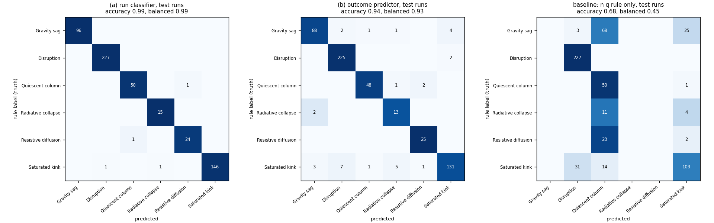
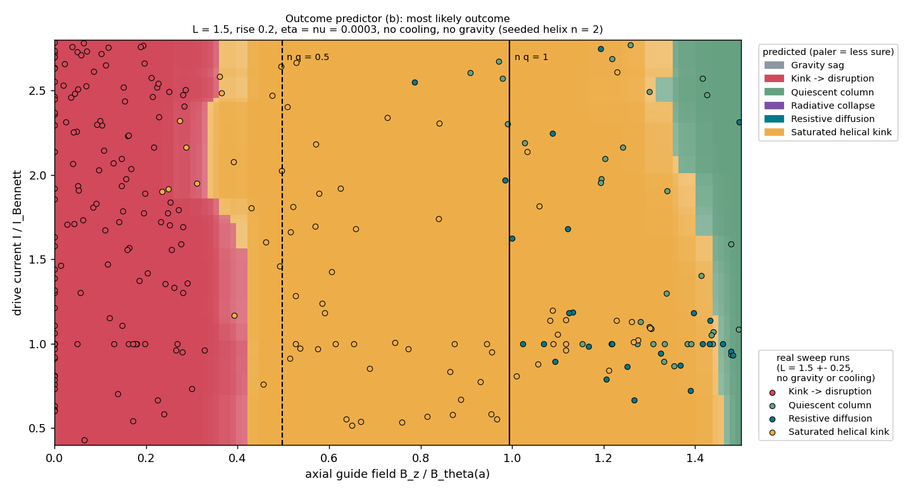

# 05.2 · V3 Phase 3: the machine-learning part, from zero

> [!abstract] One-sentence version
> Two models learned from the ~2900 overnight simulations. **(a)** looks at a finished run and says what happened (99.3 % agreement with the physics rules). **(b)** looks only at the settings **before you press Start** and predicts the outcome (**94 % right** on runs it never saw, against 68 % for the best one-line physics rule). Its most important input is the Kruskal–Shafranov number $nq$.

Series: [[05 - V3 Plan]] → [[05.1 - V3 Phase 1 Results]] → **05.2 Phase 3 Machine Learning**

Built 2026-10-20. Numbers below are from the final training on the whole sweep (2807 finished runs, retrained 2026-10-20 evening; `v2/models/MODEL_CARD.md`). The first training, on 1078 runs, scored 98.6 % and 88.0 %: §3 compares the two. Claude wrote the code (see [[05 - V3 Plan#Status (2026-10-20)|who builds what]]).

---

## 1. Machine learning in five minutes

**The idea.** Instead of writing a rule ("if the core gets cold and dense, it's radiative collapse"), you show the computer many *examples* with the right answer attached, and it finds the rules itself.

**What an example looks like here.** One row of a table per simulation:

| current | B_z | length | resistivity | … | n q | **outcome** |
|---|---|---|---|---|---|---|
| 1.52 | 1.19 | 2.27 | 0.0065 | … | 0.40 | gravity sag |
| 1.00 | 0.00 | 2.55 | 0.0028 | … | 0.00 | kink → disruption |

The columns on the left are the **inputs** (in ML jargon: *features*). The last column is the **label**, the answer we want. Our labels come from the physics rules of Phase 1 ([[05.1 - V3 Phase 1 Results]]).

**The model: boosted decision trees.** A *decision tree* is a flowchart of yes/no questions: "is n q below 0.46? → is gravity above 0.3? → …" and at the bottom, an answer. One small tree is crude. *Boosting* builds a few hundred small trees one after another, and each new tree focuses on the examples the previous ones got wrong. Added together they are accurate. This is the standard tool for tables of numbers like ours (library: **scikit-learn**, model `HistGradientBoostingClassifier`).

**Probabilities, not just answers.** The model doesn't only say "saturated kink". It says "saturated kink 78 %, disruption 19 %, …". That's useful: a 51 % answer means "this run is on a knife edge".

**The one rule that matters: test on data the model never saw.** A model can memorise its examples and still be useless on new ones (*overfitting*, like a student who memorised last year's exam answers). So before anything else, **20 % of the runs were locked away** (562 runs). The models were built and tuned on the other 80 %. Only at the very end were they scored, once, on the locked-away runs. Every number in §3 is from those unseen runs.

**Tuning without cheating.** Trees have a few settings (how many leaves, how cautious). To choose them without touching the test runs, the 80 % was cut into 5 parts. Each setting was trained on 4 parts and scored on the 5th, five times round (*cross-validation*), and the best setting was kept.

**Baselines: is it actually any good?** "88 % right" means nothing on its own. If 41 % of runs are disruptions, a "model" that always says *disruption* is already 41 % right. So the models are compared against:
1. always guessing the commonest class;
2. the best **one-line physics rule**: use only $nq$ (below 0.5 → disruption, 0.5–1.25 → saturated kink, above → quiescent).

The ML is only worth having if it beats the physics rule.

**Calibration: are the probabilities honest?** When the model says "80 %", is it right about 80 % of the time? The *calibration error* (ECE) measures the average gap: 0 is perfectly honest.

---

## 2. The two models

| | (a) Run classifier | (b) Outcome predictor |
|---|---|---|
| **Question** | "What happened in this finished run?" | "What *will* happen if I press Start with these settings?" |
| **Inputs** | all 64 features of the finished run: kink amplitude, growth rate, energy flows, … | only the settings and numbers computed from them (n q, Kadomtsev margin, resistive and cooling times) |
| **Where you see it** | report, section "Machine-learning view" | GUI, under the Run buttons: "Predicted outcome by t = 3: …" (updates as you move sliders); also in the report |
| **Honest value** | Mostly re-learns the rules, so high agreement is expected. Its value is the **probabilities** (how clear-cut a run is) and the **disagreements**, which point at weak spots in the rules. | **New capability**: an instant forecast with no simulation. Meaningful only inside the region the sweep covered, and it says when you leave it. |

Code: `v2/zpinch/analysis/model.py` (using the models), `v2/tools/train.py` (training + evaluation + model card). Saved models: `v2/models/`.

---

## 3. Results (562 test runs never seen in training)

| | accuracy | balanced accuracy* | calibration error |
|---|---|---|---|
| **(a) run classifier** | **99.3 %** | 98.8 % | 0.005 |
| **(b) outcome predictor** | **94.3 %** | 93.3 % | 0.021 |
| one-line physics rule (n q only) | 67.6 % | 44.6 % | n/a |
| always "disruption" | 40.4 % | 16.7 % | n/a |

\* *Balanced accuracy* averages the hit rate of each class equally, so the rare classes count as much as the common ones. It's lower than plain accuracy because the rare classes are harder.

On the "broad" runs only (a fair random sample of the whole box): (a) 99.7 %, (b) 96.2 %.

**More data helped (b) most.** The first training, on 1078 runs (216 test runs), gave (a) 98.6 % and (b) 88.0 %, with balanced accuracy 76 %. With 2.6× the runs, (b) went to 94.3 % and its balanced accuracy to 93 %. The gain is almost all in the thin classes, which is exactly why the sweep was resumed. (a) had little room to improve.

**(b), class by class.** It recognises 99 % of disruptions, 94 % of quiescent columns, 92 % of gravity sags, 89 % of saturated kinks, all 25 resistive runs and 13 of the 15 radiative collapses (first training: 3 of 6). Its weak spot is the other direction for radiative collapse: only 65 % of its *collapse* predictions are right. Cooling near the collapse threshold sometimes collapses and sometimes doesn't, depending on the random seed it can't see.


*(`v2/models/confusion.png`: rows = the true label, columns = the prediction; a perfect model has numbers only on the diagonal.)*

**What (b) relies on.** If you scramble one input and see how much accuracy drops, the inputs that matter most are:

| input | accuracy lost when scrambled |
|---|---|
| **n q of the seeded helix** | **56 %** |
| gravity | 17 % |
| resistivity | 8 % |
| cooling | 5 % |
| drive current | 4 % |
| everything else | ~1 % or less |

That's the physics of [[05.1 - V3 Phase 1 Results]] §5 rediscovered by the model: **Kruskal–Shafranov decides the kink, then gravity, resistivity and cooling decide the rest.** The drive current matters only a little, which matches the Phase 1 finding that extra current flows in the sheath, not the column.

### The outcome map



*(`v2/models/outcome_map.png`)* The model's prediction over axial field (across) × drive current (up), all else at the GUI defaults. The vertical lines are $nq = 0.5$ and $nq = 1$ for the seeded helix. Dots are real sweep runs with a similar column length. Read it like a phase diagram: **disruption** left of $nq \approx 0.35$–$0.45$, **saturated kink** in the middle, **quiescent** only at the far right ($nq \gtrsim 1.4$). Between $nq = 1$ and $1.5$ the real runs are a mix (saturated, quiet, resistive), and the map shows the model is less sure there.

**Calibration.** (a) is nearly perfectly honest (0.005). (b) is honest to about 2 percentage points on average (0.021). When it is very sure (> 95 %) it is right 98 % of the time. When it says 55–75 % it is a bit over-confident (right 46–67 % of the time); those are the borderline settings.

### The ML found a weak spot in the rules

On the first training's test runs, (a) disagreed with the rules three times. One of them, **r00817**, was labelled *disruption* with **high** confidence by the rules. The classifier said *saturated kink* (87 %). Looking closer: the column spread out 0.97 time units after the kink went nonlinear, and the rule's cut-off is 1.0. So it was a coin flip that the rules didn't know about. The rules now flag that delay as borderline (`rules.py`, `borderline()`). This is exactly the job the plan gave (a): **check the rules, don't replace them**.

**It happened again on the full sweep.** Of the 4 disagreements, **r02076** was a *high*-confidence saturated kink that the classifier called a radiative collapse (69 %). Its core cooled to 0.42 T₀ while 2.3× denser, and a collapse is declared below 0.40 T₀. The rules only checked closeness to the thresholds of the class they picked, so a near miss on the higher-priority collapse went unnoticed. They now flag "nearly a radiative collapse" (3 runs in the sweep). After that fix, **all 4 disagreements are runs the rules themselves call low-confidence**: the classifier never contradicts a confident rule label.

---

## 4. Honest limits

- **The labels come from rules, not from nature.** If a rule is wrong, both models learn the same mistake. (a) agreeing 99.3 % with the rules says the rules are *learnable and consistent*, not that they are *right*.
- **(b) only knows the swept box at 32³** with the default radius, background density and seed perturbation. Outside it, the GUI adds a warning: "outside the training sweep", "the sweep kept … at the default: rough guess", or "few training runs near these settings".
- **Random seed:** two runs with identical settings but different random seeds can end differently near a boundary. (b) can't see the seed, which caps how accurate it can ever be.
- **Small test classes:** 15 radiative-collapse and 25 resistive test runs, so those per-class numbers could easily be ±10–20 %.

---

## 5. How to use it

```bash
# from v2/
.venv/bin/python tools/train.py dataset/sweep-2026-10-19     # retrain (~10 min while a sweep runs)
./run.sh --headless --t-end 3 --analyse                     # report now ends with the ML view
```

- **GUI:** the "Predicted outcome by t = 3" line under the Run buttons updates as you move any slider.
- **Model card** (all the numbers, regenerated by every training run): `v2/models/MODEL_CARD.md`. The full metrics are in `metrics.json`, and the runs where (a) and the rules disagree are in `disagreements.md`.

---

## 6. What's next

- **When today's sweep finishes** (deadline 18:16), re-label and retrain on all runs. The thin classes should improve; the model card will say by how much.
- Phase 4: the curated write-up library. Phase 5: the full GUI report panel. Phase 6: note 06 and the demo.
