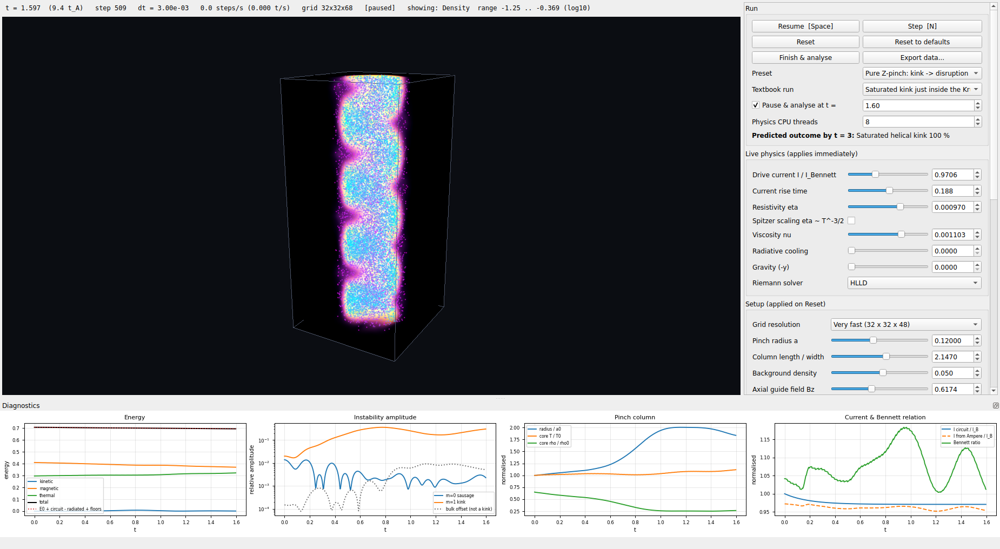
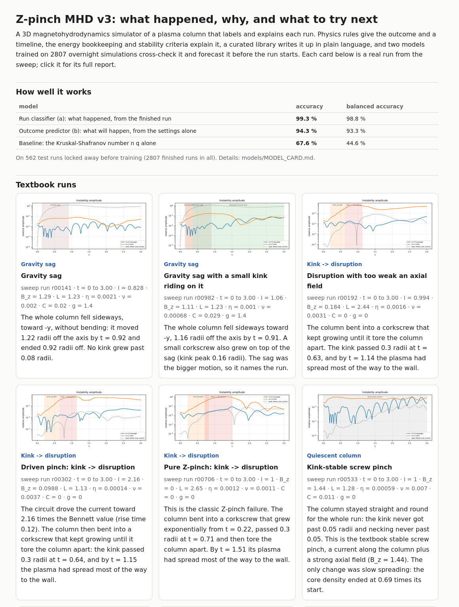

# Z-Pinch MHD v2

Interactive 3D resistive-MHD simulation of a Z-pinch plasma column: a Bennett
equilibrium driven by an external circuit, with live controls, GPU volume
rendering, tracer particles and exact energy bookkeeping. v3 (same folder)
labels, explains and forecasts each run.

Full documentation (Obsidian notes) lives in `../docs/`:
`01 - Vision`, `02 - V1 and Why It Failed`, `03 - V2 Changes and Fixes`, `04 - V2 Complete Guide`,
`05 - V3 Plan`, `05.1 - V3 Phase 1 Results` (run labelling and explanations),
`05.2 - V3 Phase 3 Machine Learning` (run classifier + outcome predictor, from zero),
`05.3 - V3 Phase 4 Write-up Library`, `05.4 - V3 Phase 5 Report Panel`,
`06 - V3 Technical Overview` (all of v3, from zero; start here).

## Results (v3)

Trained and tested on one overnight sweep of 2902 simulations (562 runs locked away for testing):

| | accuracy | balanced accuracy |
|---|---|---|
| Run classifier: what happened, from the finished run | 99.3 % | 98.8 % |
| **Outcome predictor: what will happen, from the settings alone** | **94.3 %** | 93.3 % |
| Baseline: the Kruskal-Shafranov number n q alone | 67.6 % | 44.6 % |

The sweep reproduces the Kruskal-Shafranov criterion with no physics put in by hand: of the runs without
gravity or cooling, 108 of 108 with 0.5 <= n q < 1 saturate as a bent helix, and none of the 110 with
n q >= 1.5 grows a kink. Every run gets a plain-language report (what happened, why, what to try next)
from a curated, data-checked library.
How it all works, from zero: `docs/06 - V3 Technical Overview.md`. Demo gallery: `tools/demo.py`.

## Demo and screenshots

Two runs, sped up: with an axial field the kink grows and then saturates; without one, at three times the
Bennett current, it tears the column apart. The full 55-second demo, including both runs' reports, is
[screenshots/zpinch-demo.mp4](screenshots/zpinch-demo.mp4).


A textbook run paused at t = 3: the column has bent into a helix and stopped (a saturated kink), and the
run report on the right explains why, with the sweep statistics behind the claim.


The same run at t = 1.6, with the kink at its largest:



The demo gallery (`tools/demo.py`): headline scores and one card per textbook run, each linking to its
full standalone report.



## Run

```bash
./run.sh                    # GUI
./run.sh --headless --t-end 2 --set current=1.5 axial_field=0.8 --export run.zip
./run.sh --headless --t-end 3 --preset "Saturated kink (Bz = 0.6)" --analyse   # + outcome report
./run.sh --headless --t-end 3 --preset "Stable screw pinch" --report stable.html  # standalone HTML report
./test.sh                   # physics, analysis, library and report tests
.venv/bin/python tools/analyse.py dataset/sweep-2026-10-19        # label a whole sweep
.venv/bin/python tools/train.py dataset/sweep-2026-10-19          # train + evaluate the models
.venv/bin/python tools/demo.py dataset/sweep-2026-10-19 demo/     # browsable gallery of textbook runs
```

First launch compiles the numba kernels (~20-40 s, cached afterwards).

## Setup from scratch

```bash
python3 -m venv .venv            # needs python3-venv; see docs if ensurepip is missing
.venv/bin/python -m pip install -r requirements.txt
```

## Layout

```
main.py                 entry point (GUI / --headless)
zpinch/constants.py     units, variable slots, floors, CFL, BC codes
zpinch/kernels.py       numba kernels: HLLD/HLL, PLM, GLM, resistive+viscous fluxes, diagnostics, tracers
zpinch/solver.py        generic 3D MHD solver (SSP-RK2, ghost cells, dt, energy/mass budget)
zpinch/pinch.py         Z-pinch problem: Bennett equilibrium, drive circuit, tracers, diagnostics
zpinch/params.py        setup + live parameters (metadata drives the GUI)
zpinch/diagnostics.py   plots + zip export
zpinch/analysis/        v3: features, physics rules (outcome class + timeline), explanations, ML models,
                        curated write-up library (library/, writeup.py), HTML report (report.py)
models/                 v3: trained models + MODEL_CARD.md, confusion/calibration/outcome-map figures
zpinch/gui/             Qt window, vispy 3D view, controls, physics worker process
tools/sweep.py          v3: overnight parameter sweep -> dataset/ (resumable)
tools/analyse.py        v3: label/explain one saved run or a whole sweep
tools/train.py          v3: train/evaluate run classifier (a) and outcome predictor (b)
tools/library.py        v3: write-up library upkeep (stats, check, show, replay the textbook runs)
tools/demo.py           v3: demo gallery (headline scores + every textbook run's HTML report)
tests/                  Sod, Alfven wave, diffusion, energy budget, equilibrium, kink growth; run analysis
examples/               toy_advection.py, toy_muscl.py - tiny NumPy demos used in the docs
```
